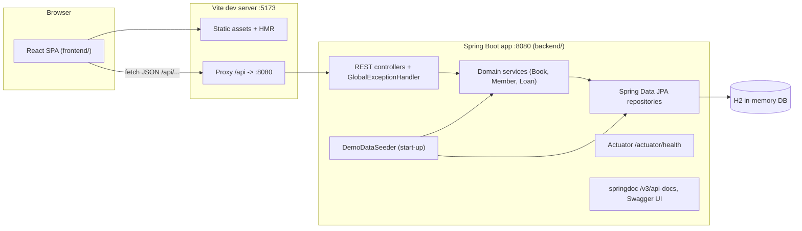
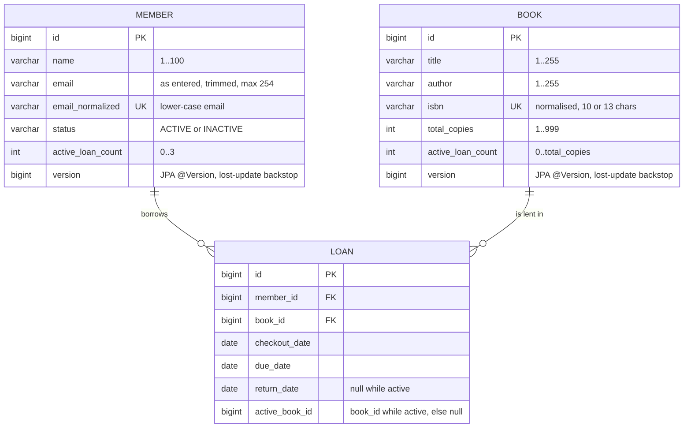
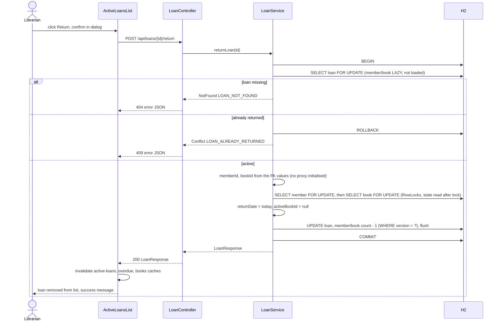
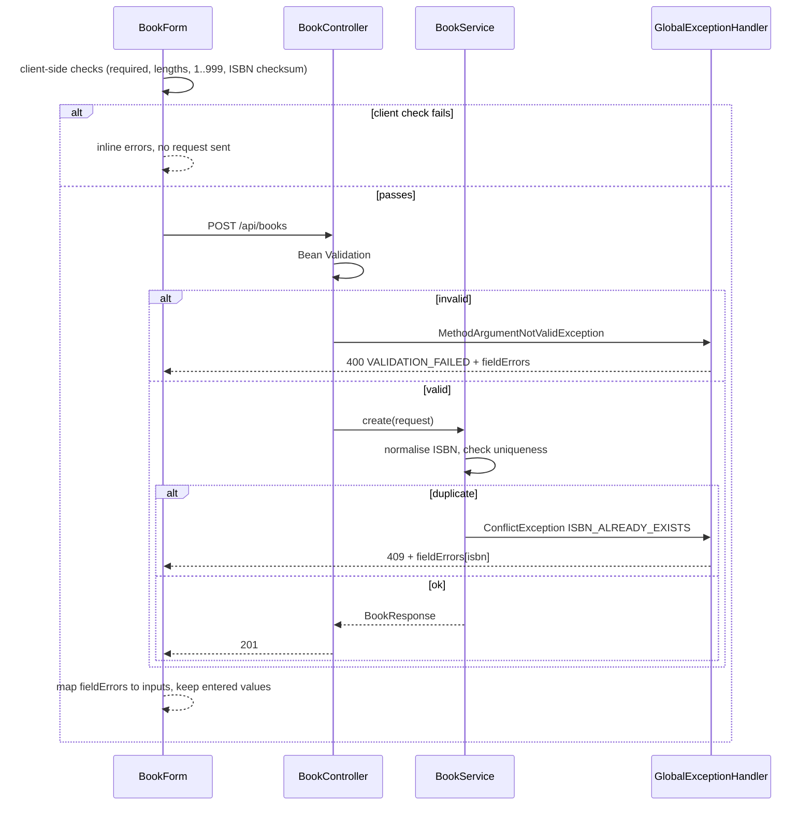

# Architecture

**Status:** approved 2026-11-25; revised after design review (DR-1..DR-20, adopted by the user on 2026-11-25); revision approved at the Stage 3 gate on 2026-11-25
**Owner:** `architecture` agent | **Approved by user:** yes (2026-11-25)
**Inputs:** `.claude/docs/requirements.md` (user-approved 2026-11-25), `workflow/brief.md`, repository contents (greenfield: no `backend/` or `frontend/` exists yet, so there are no existing code conventions to follow)

Conventions: requirement IDs (`US-n`, `FR-n`, `AC-n.BE/FE.m`, `AC-X.n`, `NFR-n`, `C-n`) refer to `.claude/docs/requirements.md`. Decisions are numbered `ADR-n` (section 11). Items marked **[CONFIRMED Dn]** follow the option chosen by the user on 2026-11-25 for decision `Dn` (section 2.2; in every case the recommended option). Items marked **[FIXED]** were decided by the user before this stage and are not reopened. Items marked **[DR-n]** were changed or added by the Stage 3 design review (`.claude/docs/design-review.md`, finding DR-n) after the user adopted the recommendation on 2026-11-25. They refine D1-D9 and Q-A1 and do not reopen them.

---

## 1. Context and goals

A single librarian uses a browser-based single-page application (SPA) to manage a book catalogue (US-1), search it (US-2), manage members (US-3), and issue/return books with an overdue list (US-4). The SPA talks to a REST/JSON backend that stores data in an in-memory H2 database, reloaded with demo data on every start (FR-24, NFR-7). There is no authentication (C-4); the system is for local/trusted use only (NFR-6).

Architecture goals, in priority order:

1. **Correct business rules under concurrency** - copy availability never negative, never more than 3 active loans per member, no duplicate active loan of the same book (AC-4.BE.11, NFR-5). Enforced in the database, not only in Java code.
2. **One consistent API contract and error format** (FR-22, AC-X.1, NFR-13) that the frontend maps directly onto inline field errors (AC-1.FE.3, AC-3.FE.2).
3. **Testability** - every backend acceptance criterion automatable (NFR-11), including date-dependent rules (overdue, due date) through an injectable clock.
4. **Accessibility** - WCAG 2.1 AA on all screens (NFR-3), which drives the frontend component choices.
5. **Simplicity** - two processes (C-8), one backend module, one frontend app; no caches, queues, or services that the requirements do not justify. The data volume ceiling (10,000 books / 1,000 members / 10,000 loans, NFR-1) is small enough for straightforward SQL on an in-memory database.

Non-goals (from requirements section 10): authentication, persistence across restarts, deployment/CI, containerisation, member portal, fines/renewals/reservations.

---

## 2. Technology

### 2.1 Fixed decisions [FIXED]

| ID | Decision | Source |
|---|---|---|
| F-1 | Backend: Java 21, Spring Boot 3 (latest 3.x patch release available at implementation time, and **at least 3.2**, so that unknown routes raise `NoResourceFoundException` **[DR-6]**), Maven, in `backend/`. | C-1, brief |
| F-2 | Frontend: React + TypeScript, built with Vite, in `frontend/`. | C-2, brief |
| F-3 | Database: H2 in-memory (`jdbc:h2:mem:...`), data resets on restart. | C-3, NFR-7 |
| F-4 | No authentication/authorisation. | C-4, NFR-6 |
| F-5 | Repo layout: `backend/` and `frontend/` at project root; two independently started processes. | C-8, brief |
| F-6 | Toolchain: Java 21, Maven 3.10, Node 24 / npm 11. | C-6, brief |

Implied by F-1 and treated as standard (no real alternative worth a decision): Spring Web MVC (servlet, blocking - simplest fit for a JDBC database), Jakarta Bean Validation (Hibernate Validator), Jackson for JSON, Spring Boot Actuator for the health endpoint (NFR-9), SLF4J + Logback for logging, and `spring-boot-starter-test` (JUnit 5, AssertJ, Mockito, MockMvc) for backend tests. Implied by F-2: React 19, TypeScript in strict mode, ESLint with `typescript-eslint`, `eslint-plugin-react-hooks` and `eslint-plugin-jsx-a11y` (the last supports NFR-3).

### 2.2 Technology choices (decided by the user on 2026-11-25)

Each choice below lists the 2-3 options that were considered, with trade-offs and the recommendation. The user chose the recommended option for every decision D1..D9 on 2026-11-25; the options table is kept as the record of the alternatives.

#### D1 - Backend persistence access

| Option | Pros | Cons | Fit |
|---|---|---|---|
| **A. Spring Data JPA (Hibernate)** | Least code for CRUD; built-in pagination types; `@Lock(PESSIMISTIC_WRITE)` gives `SELECT ... FOR UPDATE` declaratively; Specifications/JPQL handle the optional AND-combined filters (AC-2.BE.1); widely known. | ORM subtleties (persistence-context caching, flush timing, lazy loading) must be handled deliberately for the locking flow; more "magic". | Good. All queries are simple; the locking flow is a few lines once the rules in section 7 are followed. |
| B. Spring JDBC (`JdbcClient`) with hand-written SQL | Fully explicit SQL, locks and updates; no ORM surprises; small dependency footprint. | Hand-written row mappers, dynamic WHERE building for filters, and pagination count queries; more boilerplate per entity. | Good, slightly more code. |
| C. jOOQ | Type-safe SQL, excellent for dynamic filters. | Code generation step against a schema adds build complexity; less familiar; overkill for 3 tables. | Adequate but heavy. |

**Recommendation: A (Spring Data JPA)** with the explicit locking/flush rules in section 7.3. **Decision: A, chosen by the user on 2026-11-25. [CONFIRMED D1]**

#### D2 - Schema management

| Option | Pros | Cons | Fit |
|---|---|---|---|
| **A. Explicit `schema.sql` run by Spring SQL init + Hibernate `ddl-auto=validate`** | The schema (CHECK constraints, named unique constraints, indexes) is written down and reviewable; constraint names are stable so violations can be mapped to error codes; Hibernate validates entity mapping against it at start-up. | Two places to keep aligned (schema and entities) - caught by `validate` at start-up. | Best fit: the concurrency guarantees rely on named DB constraints. |
| B. Hibernate `ddl-auto=create` | Zero schema files. | CHECK constraints and constraint names are awkward to express via annotations; generated DDL is implicit and harder to review. | Weak for goal 1. |
| C. Flyway migrations | Versioned migrations; ready for a future persistent database. | Migration tooling for a database that is recreated on every start adds ceremony with no current benefit. | Over-engineered for C-3. |

**Recommendation: A.** **Decision: A, chosen by the user on 2026-11-25. [CONFIRMED D2]**

#### D3 - Concurrency enforcement for checkout/return (AC-4.BE.11, NFR-5)

| Option | Pros | Cons | Fit |
|---|---|---|---|
| **A. Pessimistic row locks + counter columns + database CHECK/UNIQUE constraints** | Requests for the same member or book are serialised by `SELECT ... FOR UPDATE` in a fixed lock order; the invariants are additionally guaranteed by the database (counter CHECKs, a unique key against duplicate active loans), so even a locking bug cannot violate them. Losers get a precise business error (e.g. `NO_COPY_AVAILABLE`). Counters also make the availability filter and list queries cheap. | Counters are denormalised and must only change inside `LoanService`; lock waits under contention (negligible for a single librarian). | Strongest guarantee, simple to test. |
| B. Optimistic locking (`@Version`) + retry | No blocking. | Losers get a generic conflict or require a retry loop; still needs counters or a count query to detect "last copy"; harder to produce the specific error message required by AC-4.FE.3. | Adequate. |
| C. JVM-level locks (`synchronized` / striped locks in the service) | Trivial to write. | Only correct for one JVM instance and only if every write path uses the lock; the database stays unprotected. | Fragile; not recommended. |

**Recommendation: A**, designed in section 7.3. **Decision: A (lock order loan -> member -> book, counter columns, CHECK/UNIQUE backstops), chosen by the user on 2026-11-25. [CONFIRMED D3]**

Refinement within D3 after the design review **[DR-1..DR-4]**: the pessimistic locks and counter columns stay. Three things are added. First, a JPA `@Version` column on `book` and `member` is the lost-update backstop. The CHECK constraints alone do not catch a stale counter write, because Hibernate writes absolute values. Second, every write path to `book`/`member` takes the row lock first, including member edit. Third, `Loan` associations are LAZY, and locks are taken via `find`/`refresh` with `PESSIMISTIC_WRITE` before any state is read. See section 7.3, ADR-23 and ADR-24.

#### D4 - Frontend library set

| Concern | **Option A - lean standard set (recommended)** | Option B - minimal (no extra libraries) | Option C - full component framework |
|---|---|---|---|
| Routing | React Router (v7, declarative mode) | Hand-rolled state switch / hash routing | React Router |
| Server state / data fetching | TanStack Query over a small `fetch` wrapper | `fetch` + custom `useEffect` hooks | Redux Toolkit + RTK Query |
| Forms | React Hook Form + hand-written validator functions | Controlled components + custom validation | Formik / MUI form fields |
| UI / styling | Semantic HTML + CSS Modules + native `<dialog>` | Semantic HTML + plain CSS | MUI (Material UI) |
| Pros | Each library solves a requirement directly: URL-addressable screens and filters in the query string (AC-X.2, AC-2.FE.4); built-in loading/error/retry states and cache invalidation after mutations (AC-1.FE.6/7, AC-X.3); `setError` maps backend `fieldErrors` to fields (AC-1.FE.3). Small bundle; full control over accessible markup. | Zero dependencies. | Ready-made accessible widgets (autocomplete, dialog, table); consistent look. |
| Cons | Accessible widgets (dialog, searchable picker) are built in-house (kept simple, see section 9.4). | Re-implements caching, retries, URL state, form state - more code and more bugs. | Large dependency and bundle; Redux is unnecessary for server-only state; theming must be checked for 4.5:1 contrast; heavier learning curve. |

**Recommendation: Option A.** **Decision: Option A (React Router, TanStack Query, React Hook Form, CSS Modules, native `<dialog>`), chosen by the user on 2026-11-25. [CONFIRMED D4]**

#### D5 - Frontend test tooling

| Option | Pros | Cons |
|---|---|---|
| **A. Vitest + React Testing Library + user-event + MSW (Mock Service Worker) + vitest-axe** | Native to Vite (same config and transforms); RTL tests behave like a user (labels, roles - which doubles as an accessibility check); MSW mocks the HTTP API at the network layer so the real `fetch` wrapper and error parsing are exercised; vitest-axe gives the automated accessibility check required by NFR-3. | No real-browser coverage (jsdom). |
| B. Jest + RTL | Very widely known. | Extra configuration for ESM/TypeScript with Vite; duplicate transform pipeline. |
| C. Option A plus Playwright end-to-end tests against both running processes | Real-browser, full-stack confidence. | Browser download and two-process orchestration; slower; CI/deployment is out of scope. |

**Recommendation: A.** Playwright can be added later without changing the architecture. **Decision: A (Vitest + React Testing Library + user-event + MSW + vitest-axe), chosen by the user on 2026-11-25. [CONFIRMED D5]**

#### D6 - API documentation (NFR-13)

| Option | Pros | Cons |
|---|---|---|
| **A. springdoc-openapi (2.x, Spring Boot 3 compatible): generated OpenAPI 3 document at `/v3/api-docs` + Swagger UI at `/swagger-ui.html`, annotated with the error schema** | Machine-readable, generated from code so it stays in sync (NFR-13); interactive try-out for manual verification. | One extra dependency; annotations needed for error responses and descriptions. |
| B. Hand-written `backend/API.md` (markdown) | No dependency. | Drifts from implementation unless reviewed every change. |
| C. Both (OpenAPI generated + short README section pointing to it and documenting the error format) | Best discoverability. | Slightly more documentation effort. |

**Recommendation: C** in its light form: springdoc-openapi is the source of truth; the README lists the endpoints and the error format briefly and links to Swagger UI. **Decision: C in its light form (springdoc-openapi plus a short README summary of endpoints and error format), chosen by the user on 2026-11-25. [CONFIRMED D6]**

#### D7 - Frontend-backend integration in development and browser hardening

| Option | Pros | Cons |
|---|---|---|
| **A. Vite dev-server proxy (`/api` -> `http://localhost:8080`), no CORS configured on the backend, plus a required custom header `X-Requested-With: library-ui` on mutating requests** | Browser sees one origin, so no CORS configuration is needed; with no CORS allowed, any other website's script cannot read responses, and the custom header forces a CORS preflight for cross-site writes, which the backend refuses - a cheap cross-site request forgery (CSRF) mitigation for a no-auth API (NFR-6). | Requests must go through the Vite dev server (documented in README); Swagger UI and tests must send the header for writes (tests do; Swagger UI can be configured to add it). |
| B. Backend CORS allowing `http://localhost:5173`, SPA calls the backend directly | No proxy. | Two origins to configure; CORS misconfiguration risk; no CSRF mitigation unless added separately. |
| C. Both proxy and CORS | Flexible. | Redundant configuration. |

**Recommendation: A.** **Decision: A (Vite proxy `/api` -> `:8080`, no CORS, required `X-Requested-With: library-ui` header on mutating requests), chosen by the user on 2026-11-25. [CONFIRMED D7]**

Refinement within D7 after the design review **[DR-7, DR-17]**: the same `RequiredHeaderFilter` also does the following:
- It enforces a `Host` allowlist (`localhost`/`127.0.0.1` on ports 8080 and 5173) on every request.
- It rejects a mutating request that carries an `Origin` header that is not on the allowlist. This defends against DNS rebinding.
- It requires the header on every method except GET, HEAD and OPTIONS.

See section 10.1 and ADR-27.

#### D8 - Combine "Books" (US-1) and "Search" (US-2) into one screen

| Option | Pros | Cons |
|---|---|---|
| **A. One "Books" screen**: filter bar (title, author, ISBN, availability) + paginated results with availability badges + add/edit/delete actions | Matches the navigation label "Books/Search" in AC-X.2; one table component, one data hook; empty-catalogue state (AC-1.FE.7) vs no-matches state (AC-2.FE.5) are distinguished by whether filters are applied. | One screen carries two stories' criteria (both remain separately testable). |
| B. Separate "Books" management list and "Search" screen | Mirrors the story split exactly. | Two near-identical tables; more navigation. |

**Recommendation: A.** **Decision: A (one combined Books screen for US-1 and US-2), chosen by the user on 2026-11-25. [CONFIRMED D8]**

#### D9 - Small API semantics needed by the UI

| Option | Pros | Cons |
|---|---|---|
| **A. Add optional `search` (name or email contains, case-insensitive) to `GET /api/members`; make deactivate/reactivate idempotent (no error when already in the target state)** | Server-side search scales to 1,000 members for the searchable active-member picker (AC-4.FE.1); idempotent actions avoid spurious errors on double-clicks or stale lists. | Slight extension of the AC-3.BE.8 list API (additive, optional). |
| B. No `search` parameter: picker loads active members page by page and filters client-side; no-op state changes return 409 | API exactly as written in AC-3.BE.8. | Picker either loads up to 1,000 records or only searches the current page; extra error cases for the UI. |

**Recommendation: A.** **Decision: A (optional `search` on `GET /api/members`; deactivate/reactivate succeed without error if already in the target state), chosen by the user on 2026-11-25. [CONFIRMED D9]**

### 2.3 Selected stack

**Selected stack (user-approved):** fixed parts F-1..F-6 approved before this stage; choices D1..D9 decided by the user on 2026-11-25 (recommended option in each case):

| Decision | Choice |
|---|---|
| D1 | Spring Data JPA (Hibernate) |
| D2 | Explicit `schema.sql` + Hibernate `ddl-auto=validate` |
| D3 | Pessimistic row locks in fixed order loan -> member -> book + counter columns + DB CHECK/UNIQUE backstops |
| D4 | React Router + TanStack Query + React Hook Form + CSS Modules + native `<dialog>` |
| D5 | Vitest + React Testing Library + user-event + MSW + vitest-axe |
| D6 | springdoc-openapi (2.x) + short README summary of endpoints and error format |
| D7 | Vite proxy `/api` -> `:8080`, no CORS, required `X-Requested-With: library-ui` on mutating requests |
| D8 | One combined Books screen (US-1 + US-2) |
| D9 | Optional `search` (name/email) on `GET /api/members`; idempotent deactivate/reactivate |
| Q-A1 | ISBN uniqueness compares normalised strings only; ISBN-10 and its ISBN-13 equivalent are distinct values |

The user approved this architecture document on 2026-11-25. The same day it was revised with the design-review changes the user adopted (D-R1..D-R6, findings DR-1..DR-20, marked **[DR-n]**). The revised document awaits the Stage 3 approval gate. These revisions do not change any of D1-D9 or Q-A1.

---

## 3. System overview



Runtime: the librarian opens `http://localhost:5173`. All API calls are relative (`/api/...`) and proxied to the backend (D7). The backend binds to `127.0.0.1:8080` by default (section 10.1).

---

## 4. Backend components and package structure

Packaging is **by feature** (book / member / loan) with a small shared `common` package, so each story's backend sub-task maps to one package. Base package: `com.library` (Maven `groupId` `com.library`, `artifactId` `library-backend`).

```
backend/
  pom.xml
  src/main/java/com/library/
    LibraryApplication.java
    book/        Book (entity), BookRepository, BookService, BookController,
                 dto/ (BookRequest, BookResponse, BookSearchCriteria), Availability (enum)
    member/      Member, MemberStatus, MemberRepository, MemberService, MemberController,
                 dto/ (MemberRequest, MemberResponse)
    loan/        Loan, LoanRepository, LoanService, LoanPolicy (constants: 14 days, max 3),
                 LoanController, dto/ (CheckoutRequest, LoanResponse, OverdueLoanResponse)
    common/
      error/     ApiError (response body), FieldErrorDto, ErrorCode (enum),
                 NotFoundException, ConflictException (business rule), ValidationException,
                 GlobalExceptionHandler (@RestControllerAdvice), ConstraintViolationTranslator,
                 ApiErrorWriter (writes ApiError JSON outside MVC), ApiErrorController (/error)
      persistence/ RowLocks (lock-then-read helper, section 7.3)
      validation/ Isbn (annotation) + IsbnValidator, IsbnNormalizer,
                  LibraryEmail (annotation) + LibraryEmailValidator
      web/       PageResponse<T>, PageRequestParams (validated page/size), RequestLoggingFilter,
                 RequiredHeaderFilter (D7: required header, Host allowlist, Origin check)
      time/      ClockConfig (java.time.Clock bean)
    seed/        DemoDataSeeder (ApplicationRunner), DemoData (fixture definitions)
    config/      JacksonConfig, OpenApiConfig (incl. OpenApiCustomizer declaring X-Requested-With)
  src/main/resources/
    application.yml, schema.sql
  src/test/java/com/library/...   (mirrors main; see section 10.6)
```

| Component | Responsibility | Depends on | Requirements |
|---|---|---|---|
| `BookController` | HTTP mapping for `/api/books`; binds and validates DTOs; no business logic. | `BookService` | FR-1..FR-9 |
| `BookService` | Create/update/delete/get/search books; ISBN normalisation and uniqueness; total-copies vs active-loans rule; delete guard; transactional. Update and delete take the book row lock before reading the book's state (section 7.3). | `BookRepository`, `LoanRepository` (bulk delete of returned loans on book delete, section 7.3 **[DR-12]**), `RowLocks` | AC-1.BE.1..8, AC-2.BE.1..6 |
| `MemberController` / `MemberService` | Register/edit/get/list members; email normalisation and uniqueness; deactivate guard; reactivate. Edit, deactivate and reactivate take the member row lock first **[DR-1]**. | `MemberRepository`, `RowLocks` | AC-3.BE.1..8 |
| `LoanController` / `LoanService` | Checkout, return, loan by id, active-loan list, overdue list. Owns all loan rules and is the **only** writer of the `active_loan_count` counters. | `LoanRepository`, `BookRepository`, `MemberRepository`, `RowLocks`, `Clock` | AC-4.BE.1..11 |
| `LoanPolicy` | Constants: loan period 14 days, max 3 active loans (not user-configurable; renewals/configuration out of scope). | - | FR-15, FR-16 |
| `GlobalExceptionHandler` | Converts every exception raised inside Spring MVC handling into the single error JSON (section 6.2); logs at the right level. Errors outside MVC are covered by `ApiErrorWriter` and `ApiErrorController` **[DR-6]**. | `Clock` (timestamp) | FR-22, AC-X.1, NFR-9 |
| `ApiErrorWriter` | Writes an `ApiError` body directly to the servlet response, using the shared `ObjectMapper` and `Clock`. Used by `RequiredHeaderFilter` **[DR-6]**. | `ObjectMapper`, `Clock` | AC-X.1 |
| `ApiErrorController` | Replaces Spring Boot's default `/error` rendering (`BasicErrorController`). Every `/error` dispatch (exceptions escaping filters, container rejections such as malformed URL/encoding or oversize headers; known exception in R-14) gets the standard body, with the status mapped to a code (section 10.2) **[DR-6]**. | `ApiErrorWriter` | AC-X.1 |
| `ConstraintViolationTranslator` | Maps a DB constraint violation to an error code **per operation**: the constraint name, compared case-insensitively, plus the calling operation (table in 6.2.1). This is a backstop for races. Each writing service method calls it around its own flush **[DR-5]**. | - | AC-1.BE.4, AC-1.BE.6, AC-3.BE.3, AC-3.BE.6, AC-4.BE.2..5, AC-4.BE.11 |
| `RowLocks` | `lock(type, id)`: acquires `PESSIMISTIC_WRITE` and returns state read **after** the lock is granted (`find` with lock, or `refresh` with lock if the entity is already managed). Throws the type-specific `NotFoundException` when the row does not exist (section 7.3) **[DR-2]**. | `EntityManager` | AC-4.BE.11, NFR-5 |
| `IsbnValidator` / `IsbnNormalizer` | ISBN-10/13 check-digit validation; strip hyphens/spaces, upper-case `x`. | - | FR-5, AC-1.BE.3, AC-2.BE.1 |
| `LibraryEmailValidator` | Pragmatic email rule from AC-3.BE.2. | - | FR-11 |
| `PageResponse`, `PageRequestParams` | Pagination envelope; validation of `page >= 0`, `1 <= size <= 100`, default 20. | - | AC-2.BE.3, AC-3.BE.8, AC-4.BE.10 |
| `ClockConfig` | Provides `Clock` (system default zone) used for "today" everywhere; replaced by a fixed/mutable clock in tests. | - | NFR-11, NFR-12 |
| `DemoDataSeeder` | Loads demo data on every start, dates relative to today. | repositories, `Clock` | FR-24, AC-X.4 |
| `RequestLoggingFilter` | Logs one line per request: method, path, the **names** of the query parameters, status and duration. Parameter values are never logged **[DR-14]**. | - | NFR-9 |
| `RequiredHeaderFilter` | Rejects, with the standard error JSON written via `ApiErrorWriter` **[DR-6]**: (1) any request whose `Host` is not on the allowlist (403 `FORBIDDEN_ORIGIN`) **[DR-7]**; (2) a mutating request whose `Origin` header is present but not on the allowlist (403 `FORBIDDEN_ORIGIN`) **[DR-7]**; (3) a mutating request without `X-Requested-With: library-ui` (403 `MISSING_REQUIRED_HEADER`) **[CONFIRMED D7]**. "Mutating" means every method except GET, HEAD and OPTIONS **[DR-17]**. | `ApiErrorWriter` | NFR-6 |
| Actuator | `/actuator/health` only. | - | NFR-9 |
| springdoc | OpenAPI document + Swagger UI. **[CONFIRMED D6]** | - | NFR-13 |

Layering rules: controllers never touch repositories; services own transactions (`@Transactional` on service methods, read-only for queries); `spring.jpa.open-in-view=false` so no lazy loading leaks into controllers; DTOs (Java records) at the API boundary, entities never serialised directly. Every write to an existing `book` or `member` row happens only after that row's lock is held (section 7.3) **[DR-1]**.

---

## 5. Data model

### 5.1 ER diagram



### 5.2 Tables, constraints and indexes (`schema.sql`, D2)

All identifiers are `BIGINT GENERATED BY DEFAULT AS IDENTITY` primary keys. Constraint names are fixed because `ConstraintViolationTranslator` maps them to error codes.

**`book`**

| Column | Type | Rules |
|---|---|---|
| `id` | BIGINT | PK |
| `title` | VARCHAR(255) NOT NULL | trimmed, non-blank (validated in API) |
| `author` | VARCHAR(255) NOT NULL | trimmed, non-blank |
| `isbn` | VARCHAR(13) NOT NULL | normalised (hyphens/spaces removed, trailing `x` upper-cased); `uk_book_isbn` UNIQUE on the normalised string. An ISBN-10 and its ISBN-13 equivalent are different strings and therefore not duplicates (Q-A1, user decision 2026-11-25). |
| `total_copies` | INT NOT NULL | `ck_book_total_copies`: `total_copies BETWEEN 1 AND 999` |
| `active_loan_count` | INT NOT NULL DEFAULT 0 | `ck_book_active_loans`: `active_loan_count >= 0 AND active_loan_count <= total_copies` |
| `version` | BIGINT NOT NULL DEFAULT 0 | JPA `@Version`. Incremented on every update, and every UPDATE is conditional on it. It is the lost-update backstop (section 7.3) and is not exposed in the API **[DR-3]**. |

Derived (not stored): `available_copies = total_copies - active_loan_count` (AC-1.BE.1, AC-2.BE.6). The CHECK guarantees two things even if a service check were bypassed: available copies is never negative (AC-4.BE.11), and total copies cannot drop below active loans (AC-1.BE.6). The CHECK only bounds the stored value. It cannot detect a counter that has drifted from the loan rows through a lost update that stays inside the range. The `version` column catches that case (section 7.3) **[DR-3]**.

Indexes: `uk_book_isbn` (also serves ISBN equality checks); `ix_book_title_isbn (title, isbn)` for the default ordering.

**`member`**

| Column | Type | Rules |
|---|---|---|
| `id` | BIGINT | PK |
| `name` | VARCHAR(100) NOT NULL | trimmed, non-blank |
| `email` | VARCHAR(254) NOT NULL | trimmed, as entered (display value) |
| `email_normalized` | VARCHAR(254) NOT NULL | `lower(email)` set by the entity on persist/update; `uk_member_email` UNIQUE -> case-insensitive uniqueness (FR-11, AC-3.BE.3) |
| `status` | VARCHAR(8) NOT NULL | `ck_member_status`: `status IN ('ACTIVE','INACTIVE')` |
| `active_loan_count` | INT NOT NULL DEFAULT 0 | `ck_member_active_loans`: `active_loan_count BETWEEN 0 AND 3` (AC-4.BE.11) |
| | | `ck_member_inactive_no_loans`: `status = 'ACTIVE' OR active_loan_count = 0` (AC-3.BE.6) |
| `version` | BIGINT NOT NULL DEFAULT 0 | JPA `@Version`, the same lost-update backstop as on `book`. It protects `active_loan_count` and `status` against stale full-row writes (section 7.3). Not exposed in the API **[DR-1, DR-3]**. |

Indexes: `uk_member_email`; `ix_member_name_id (name, id)` for ordering; `ix_member_status (status)` for the status filter.

**`loan`**

| Column | Type | Rules |
|---|---|---|
| `id` | BIGINT | PK |
| `member_id` | BIGINT NOT NULL | FK `fk_loan_member` -> `member(id)` (members are never deleted) |
| `book_id` | BIGINT NOT NULL | FK `fk_loan_book` -> `book(id)`, no cascade: the service deletes a book's returned loans explicitly before deleting the book (AC-1.BE.8, Q6), so a stray delete of a book with loans fails loudly |
| `checkout_date` | DATE NOT NULL | |
| `due_date` | DATE NOT NULL | `ck_loan_due`: `due_date >= checkout_date` |
| `return_date` | DATE NULL | `ck_loan_return`: `return_date IS NULL OR return_date >= checkout_date` |
| `active_book_id` | BIGINT NULL | `ck_loan_active_key`: `(return_date IS NULL AND active_book_id IS NOT NULL AND active_book_id = book_id) OR (return_date IS NOT NULL AND active_book_id IS NULL)`. Tightened during implementation (accepted by the user 2026-11-25): without `active_book_id IS NOT NULL`, a row with `return_date` NULL and `active_book_id` NULL makes `active_book_id = book_id` UNKNOWN, a CHECK passes on UNKNOWN, and that active loan would also escape `uk_loan_member_active_book`. |
| | | `uk_loan_member_active_book` UNIQUE `(member_id, active_book_id)` - H2 allows multiple NULLs in a unique key, so only *active* loans are constrained: one active loan per member per book (AC-4.BE.5). This is a portable substitute for a partial unique index, which H2 does not support. |

Indexes: `ix_loan_member_active (member_id, return_date)`; `ix_loan_book_active (book_id, return_date)`; `ix_loan_overdue (return_date, due_date)` for the overdue query.

Entity mapping **[DR-2]**: `Loan.member` and `Loan.book` are `@ManyToOne(fetch = FetchType.LAZY, optional = false)`. They are explicitly LAZY because the JPA default (EAGER) would load the member and book before their locks are taken (section 7.3). `Loan` has no `version` column. A loan is only modified under its own row lock and is returned at most once (`ck_loan_active_key`). Loan lists are read with dedicated fetch-join queries (section 6.3) **[DR-8]**.

Counter invariant (verified by tests and by the seeder): for every book and member, `active_loan_count` equals the number of its loans with `return_date IS NULL`. Only `LoanService` (and the seeder, through the same entity methods) changes counters. Other writers of `book`/`member` rows (book update, member edit/deactivate/reactivate) hold the row lock, and the `version` column rejects any write based on stale state **[DR-1, DR-3]**.

Dates are `DATE` (`java.time.LocalDate`), no time component; "today" is `LocalDate.now(clock)` in the server's default zone (NFR-12). Days overdue = `today - due_date` in days, computed by the service, never stored.

Volume check (NFR-1): 10,000 books in memory - a case-insensitive "contains" filter is a full scan (`LIKE` with a leading wildcard cannot use an index), which on H2 in-memory is a few milliseconds to tens of milliseconds at this size, well inside the 500 ms p95 target. No full-text index is needed.

### 5.3 Normalisation rules

| Value | Normalisation | Where |
|---|---|---|
| ISBN | Remove all hyphens and spaces; upper-case a trailing `x`. Valid if 10 chars (9 digits + digit or `X`, mod-11 check) or 13 digits (mod-10 check with weights 1/3). ISBN-10 is **not** converted to ISBN-13: uniqueness compares the normalised strings only, so an ISBN-10 and its ISBN-13 equivalent (e.g. `0306406152` and `9780306406157`) are distinct books (Q-A1, decided by the user on 2026-11-25). Stored normalised; returned normalised. | `IsbnNormalizer` (backend), `validators.ts` (frontend) |
| ISBN filter | Same strip/upper-case, then "contains" on the stored value (AC-2.BE.1). | `BookService` |
| Email | Trim (in the request record, see next row); stored as entered; `email_normalized = trimmed.toLowerCase(Locale.ROOT)` for uniqueness. `Locale.ROOT` makes the result independent of the default locale, which could otherwise change `I`/`i` handling (for example the Turkish locale) **[DR-15]**. | request record + `Member` entity |
| Title, author, name, ISBN, email | Leading/trailing whitespace is trimmed in the request record's compact constructor (null-safe), i.e. **before** Bean Validation runs, so `@NotBlank`/`@Size` apply to the trimmed value. Any case conversion uses `Locale.ROOT` **[DR-15]**. | request records (`BookRequest`, `MemberRequest`) |

### 5.4 Schema lifecycle

`schema.sql` runs on every start (Spring SQL init, embedded database), then Hibernate validates the mapping (`ddl-auto=validate`). The database URL `jdbc:h2:mem:library;DB_CLOSE_DELAY=-1` keeps the database for the life of the JVM and discards it on shutdown (C-3, NFR-7). Then `DemoDataSeeder` runs (section 8). **[CONFIRMED D2]** Tests use a unique database name per Spring test context instead of `library`, so `schema.sql` always runs against an empty database (section 10.6) **[DR-9]**.

---

## 6. API contract

Base path `/api`. JSON only (`application/json; charset=UTF-8`). Dates are ISO-8601 `yyyy-MM-dd`; the error timestamp is ISO-8601 with offset (NFR-12). Authentication: none (C-4). Mutating requests (every method except GET, HEAD and OPTIONS) must carry `X-Requested-With: library-ui` **[CONFIRMED D7]** **[DR-17]**. Every request must carry an allowlisted `Host`. A mutating request that has an `Origin` header must come from an allowlisted origin (section 10.1) **[DR-7]**.

### 6.1 Common shapes

**Pagination parameters** (books, members, active loans): `page` integer >= 0 (default 0), `size` integer 1..100 (default 20). `size > 100`, `size < 1`, `page < 0` or non-numeric values -> 400 `VALIDATION_FAILED` with a field error on `page`/`size` (AC-2.BE.3). Note: Spring Data's default `Pageable` resolver silently clamps oversize values, so these parameters are bound and validated explicitly (`PageRequestParams`) instead.

**Page envelope** (custom DTO, not Spring's `Page` serialisation):

```json
{ "content": [ ... ], "page": 0, "size": 20, "totalElements": 57, "totalPages": 3 }
```

An empty result is `200` with `"content": []`, `"totalElements": 0`, `"totalPages": 0` (AC-2.BE.5).

**BookResponse**

```json
{ "id": 1, "title": "Clean Code", "author": "Robert C. Martin", "isbn": "9780132350884",
  "totalCopies": 3, "availableCopies": 2 }
```

**MemberResponse**

```json
{ "id": 1, "name": "Ada Lovelace", "email": "ada@example.org", "status": "ACTIVE", "activeLoanCount": 1 }
```

**LoanResponse** (checkout, return, active loans)

```json
{ "id": 10, "member": { "id": 1, "name": "Ada Lovelace" },
  "book": { "id": 1, "title": "Clean Code", "isbn": "9780132350884" },
  "checkoutDate": "2026-11-25", "dueDate": "2026-12-09", "returnDate": null,
  "overdue": false, "daysOverdue": 0 }
```

`overdue` and `daysOverdue` are computed by the server with its clock so the UI never computes dates itself (NFR-12, AC-4.FE.4).

### 6.2 Error format (FR-22, AC-X.1)

Every non-2xx response uses exactly this body, with one known exception described below. That includes framework errors (malformed JSON, unknown route, wrong method, wrong media type), responses written by servlet filters, and container-level rejections that are dispatched to `/error`. Three producers guarantee this **[DR-6]**:
- `GlobalExceptionHandler`, inside Spring MVC.
- `ApiErrorWriter`, used by `RequiredHeaderFilter`.
- `ApiErrorController`, which replaces Spring Boot's default `/error` rendering. Anything that reaches `/error` therefore also gets this body, including exceptions escaping a filter, malformed URLs or encodings, and oversize headers.

Known and accepted limit (accepted by the user 2026-11-25, R-14): Tomcat rejects a few unparseable request lines (for example invalid percent-encoding such as `/bad%zzpath`) before any dispatch to the application, and answers them with its own HTML 400 page instead of the standard JSON body. The frontend treats such a response as `BACKEND_UNAVAILABLE` (ADR-31); the UI never builds such URLs itself.

The body:

```json
{
  "status": 400,
  "code": "VALIDATION_FAILED",
  "message": "The request contains invalid fields.",
  "timestamp": "2026-11-25T10:15:30.123+01:00",
  "fieldErrors": [
    { "field": "isbn", "message": "ISBN must be a valid ISBN-10 or ISBN-13." },
    { "field": "totalCopies", "message": "Total copies must be a whole number between 1 and 999." }
  ]
}
```

`fieldErrors` is always present (empty array when not a validation error), sorted by field then message for deterministic output. No stack traces, exception class names, SQL, or constraint names are ever returned (`server.error.include-stacktrace=never`, `include-message=never`; the handler builds messages itself).

| HTTP | `code` | When | AC |
|---|---|---|---|
| 400 | `VALIDATION_FAILED` | Bean Validation failure, bad query parameter, type mismatch (e.g. `totalCopies: 2.5` or `"abc"`) - with `fieldErrors` | AC-1.BE.2/3, AC-2.BE.3, AC-3.BE.2 |
| 400 | `TOTAL_COPIES_BELOW_ACTIVE_LOANS` | Update sets total copies below active loans - with `fieldErrors[totalCopies]` (also via `ck_book_active_loans` on book update, 6.2.1) | AC-1.BE.6 |
| 400 | `MALFORMED_REQUEST` | Body is not parseable JSON / missing body; also a container-level 400 rendered through `/error` **[DR-6]** | AC-X.1 |
| 403 | `MISSING_REQUIRED_HEADER` | Mutating request (any method except GET/HEAD/OPTIONS) without `X-Requested-With: library-ui` **[CONFIRMED D7]** **[DR-17]** | NFR-6 |
| 403 | `FORBIDDEN_ORIGIN` | Either the `Host` header is not on the allowlist (any method), or a mutating request carries an `Origin` header that is not on the allowlist (section 10.1) **[DR-7]** | NFR-6 |
| 404 | `BOOK_NOT_FOUND`, `MEMBER_NOT_FOUND`, `LOAN_NOT_FOUND` | Unknown identifier | AC-1.BE.5, AC-3.BE.4, AC-4.BE.6, AC-4.BE.8 |
| 404 | `NOT_FOUND` | Unknown route: `NoResourceFoundException` (Spring Boot >= 3.2), or a 404 reaching `/error` **[DR-6]** | AC-X.1 |
| 405 | `METHOD_NOT_ALLOWED` | Unsupported method on a route | AC-X.1 (same format) |
| 415 | `UNSUPPORTED_MEDIA_TYPE` | Body not `application/json` | AC-X.1 (same format) |
| other 4xx | `REQUEST_REJECTED` | Any other client error rendered by `ApiErrorController`, for example a container rejection with a status not listed above **[DR-6]** | AC-X.1 |
| 409 | `ISBN_ALREADY_EXISTS` | Duplicate normalised ISBN string on create/update (also via `uk_book_isbn`; ISBN-10 vs ISBN-13 equivalents are not duplicates, Q-A1) - `fieldErrors[isbn]` included so the UI can show it inline | AC-1.BE.4, AC-1.FE.3 |
| 409 | `EMAIL_ALREADY_EXISTS` | Duplicate email (also via `uk_member_email`) - `fieldErrors[email]` included | AC-3.BE.3, AC-3.FE.2 |
| 409 | `BOOK_HAS_ACTIVE_LOANS` | Delete of a book with active loans | AC-1.BE.7 |
| 409 | `MEMBER_HAS_ACTIVE_LOANS` | Deactivation of a member with active loans | AC-3.BE.6 |
| 409 | `LOAN_LIMIT_REACHED` | Member already has 3 active loans (also via `ck_member_active_loans`) | AC-4.BE.2 |
| 409 | `NO_COPY_AVAILABLE` | Book has 0 available copies (also via `ck_book_active_loans`) | AC-4.BE.3 |
| 409 | `MEMBER_INACTIVE` | Checkout for an inactive member | AC-4.BE.4 |
| 409 | `DUPLICATE_ACTIVE_LOAN` | Member already holds an active loan of this book (also via `uk_loan_member_active_book`) | AC-4.BE.5 |
| 409 | `LOAN_ALREADY_RETURNED` | Return of a returned loan | AC-4.BE.8 |
| 409 | `CONCURRENT_UPDATE` | Either a lock wait timed out (`PessimisticLockingFailureException`; should not happen at single-user load), or a `book`/`member` write was based on stale state and the `@Version` check failed (`OptimisticLockingFailureException`). The version check is a backstop that never fires when the rules in 7.3 are followed; it is logged at WARN **[DR-3]**. The message asks the user to retry. | AC-4.BE.11, NFR-5 |
| 500 | `INTERNAL_ERROR` | Anything unexpected; generic message; full detail logged server-side only | AC-X.1, NFR-9 |

Where a 409 carries a field error (`isbn`, `email`) this is a deliberate addition so the frontend can place the message inline (AC-1.FE.3, AC-3.FE.2); AC-X.1 requires `fieldErrors` for validation errors and does not forbid it elsewhere.

#### 6.2.1 Constraint translation (backstop) **[DR-5]**

Each writing service method wraps its own flush and catches `DataIntegrityViolationException`. It then asks `ConstraintViolationTranslator` for the code, passing **the operation and the constraint name**. The constraint name comes from Hibernate's `ConstraintViolationException`, with the H2 message as a fallback. Names are compared case-insensitively, because H2 reports unquoted names in upper case (`CK_BOOK_ACTIVE_LOANS`). A name-only mapping would be ambiguous: `ck_book_active_loans` means different things on checkout and on book update. The repository/integration constraint tests assert every row of this table (10.6).

| Constraint | Operation | HTTP | `code` |
|---|---|---|---|
| `uk_book_isbn` | create / update book | 409 | `ISBN_ALREADY_EXISTS` + `fieldErrors[isbn]` |
| `ck_book_total_copies` | create / update book | 400 | `VALIDATION_FAILED` + `fieldErrors[totalCopies]` |
| `ck_book_active_loans` | update book | 400 | `TOTAL_COPIES_BELOW_ACTIVE_LOANS` + `fieldErrors[totalCopies]` |
| `ck_book_active_loans` | checkout | 409 | `NO_COPY_AVAILABLE` |
| `fk_loan_book` | delete book | 409 | `BOOK_HAS_ACTIVE_LOANS` |
| `uk_member_email` | register / edit member | 409 | `EMAIL_ALREADY_EXISTS` + `fieldErrors[email]` |
| `ck_member_inactive_no_loans` | deactivate member | 409 | `MEMBER_HAS_ACTIVE_LOANS` |
| `ck_member_inactive_no_loans` | checkout | 409 | `MEMBER_INACTIVE` |
| `ck_member_active_loans` | checkout | 409 | `LOAN_LIMIT_REACHED` |
| `uk_loan_member_active_book` | checkout | 409 | `DUPLICATE_ACTIVE_LOAN` |
| any other constraint/operation pair (for example a counter going below 0 on return, or `ck_loan_*`) | any | 500 | `INTERNAL_ERROR`. The invariant is broken: logged at ERROR with the constraint name, which is never returned to the client. |

### 6.3 Endpoints

| Method and path | Input | Success | Errors | Story / AC |
|---|---|---|---|---|
| `GET /api/books` | query: `title`, `author`, `isbn` (each optional, at most 255 characters **[DR-18]**, case-insensitive contains; ISBN normalised), `availability` = `available` \| `unavailable` (optional, else all), `page`, `size` | 200 `Page<BookResponse>` ordered by `lower(title)`, then `isbn` | 400 | US-1/US-2: AC-1.FE.1, AC-2.BE.1..6 |
| `GET /api/books/{id}` | - | 200 `BookResponse` | 404 `BOOK_NOT_FOUND` | AC-1.BE.5 |
| `POST /api/books` | `{ "title", "author", "isbn", "totalCopies" }` | 201 `BookResponse` (+ `Location: /api/books/{id}`), `availableCopies = totalCopies` | 400, 409 `ISBN_ALREADY_EXISTS` | AC-1.BE.1..4 |
| `PUT /api/books/{id}` | same body as POST (full replacement of editable fields) | 200 `BookResponse` (available recalculated) | 400 (incl. `TOTAL_COPIES_BELOW_ACTIVE_LOANS`), 404, 409 `ISBN_ALREADY_EXISTS` | AC-1.BE.2..6 |
| `DELETE /api/books/{id}` | - | 204 (book and its returned loans removed) | 404, 409 `BOOK_HAS_ACTIVE_LOANS` | AC-1.BE.7, AC-1.BE.8 |
| `GET /api/members` | query: `status` = `ACTIVE` \| `INACTIVE` (optional), `search` (optional, at most 254 characters **[DR-18]**; case-insensitive contains on name or email - **[CONFIRMED D9]**), `page`, `size` | 200 `Page<MemberResponse>` ordered by `lower(name)`, then `id` | 400 | AC-3.BE.8, AC-4.FE.1 |
| `GET /api/members/{id}` | - | 200 `MemberResponse` | 404 | AC-3.BE.4 |
| `POST /api/members` | `{ "name", "email" }` | 201 `MemberResponse` with `status: ACTIVE` (+ `Location`) | 400, 409 `EMAIL_ALREADY_EXISTS` | AC-3.BE.1..3 |
| `PUT /api/members/{id}` | `{ "name", "email" }` | 200 `MemberResponse` | 400, 404, 409 | AC-3.BE.2..4 |
| `POST /api/members/{id}/deactivate` | no body | 200 `MemberResponse` (`INACTIVE`); idempotent if already inactive | 404, 409 `MEMBER_HAS_ACTIVE_LOANS` | AC-3.BE.5, AC-3.BE.6 |
| `POST /api/members/{id}/reactivate` | no body | 200 `MemberResponse` (`ACTIVE`); idempotent if already active | 404 | AC-3.BE.7 |
| `POST /api/loans` | `{ "memberId", "bookId" }` (both required, positive integers) | 201 `LoanResponse` (checkout today, due today + 14) (+ `Location: /api/loans/{id}`) | 400, 404 `MEMBER_NOT_FOUND`/`BOOK_NOT_FOUND`, 409 `MEMBER_INACTIVE`/`LOAN_LIMIT_REACHED`/`DUPLICATE_ACTIVE_LOAN`/`NO_COPY_AVAILABLE`/`CONCURRENT_UPDATE` | AC-4.BE.1..6, AC-4.BE.11 |
| `POST /api/loans/{id}/return` | no body | 200 `LoanResponse` with `returnDate` = today | 404 `LOAN_NOT_FOUND`, 409 `LOAN_ALREADY_RETURNED` | AC-4.BE.7, AC-4.BE.8 |
| `GET /api/loans/{id}` | - | 200 `LoanResponse` (active or returned). `overdue`/`daysOverdue` are computed for an active loan and are `false`/`0` once returned. This is the target of the checkout `Location` header **[DR-13]**. | 400 (non-numeric id), 404 `LOAN_NOT_FOUND` | AC-4.BE.1 (Location target), AC-4.BE.7 |
| `GET /api/loans/active` | query: `memberId`, `bookId` (optional, integers >= 1 **[DR-18]**), `page`, `size` | 200 `Page<LoanResponse>` ordered by `dueDate`, then `id`. Loaded with one fetch-join query plus one count query **[DR-8]**. | 400 | AC-4.BE.10, AC-4.FE.4 |
| `GET /api/loans/overdue` | - | 200 JSON array of `OverdueLoanResponse` (`LoanResponse` fields with `overdue: true`, `daysOverdue >= 1`), ordered by `dueDate` ascending then `id`; unpaginated ("all", per AC-4.BE.9). Loaded with one fetch-join query **[DR-8]**. | - | AC-4.BE.9, AC-4.FE.5 |
| `GET /actuator/health` | - | 200 `{"status":"UP"}` | - | NFR-9 |
| `GET /v3/api-docs`, `/swagger-ui.html` | - | OpenAPI 3 / UI **[CONFIRMED D6]** | - | NFR-13 |

Notes:
- The checkout order of rule checks is fixed so the error is deterministic when several rules fail: 404 member, 404 book, `MEMBER_INACTIVE`, `DUPLICATE_ACTIVE_LOAN`, `LOAN_LIMIT_REACHED`, `NO_COPY_AVAILABLE`.
- The `search` parameter on `GET /api/members` is not named in AC-3.BE.8; it is the minimal backend support for the "searchable selection" of active members required by AC-4.FE.1 (filtered client-side otherwise, which does not scale to 1,000 members). The book picker reuses the existing `title` filter. Approved by the user as decision D9 (2026-11-25).
- Idempotency: `GET`s are safe; `PUT` is idempotent; deactivate/reactivate are idempotent (no error if already in the target state - D9); `POST /api/loans` is not idempotent, but a repeated submit for the same member and book is rejected with `DUPLICATE_ACTIVE_LOAN`, which protects against double-clicks; `POST /return` repeated yields `LOAN_ALREADY_RETURNED`.
- Unknown query parameters are ignored; unknown enum values (e.g. `availability=foo`, `status=x`) -> 400 with a field error.
- Query-parameter bounds **[DR-18]**: a text filter longer than its limit (255; `search` 254) or a `memberId`/`bookId` below 1 -> 400 `VALIDATION_FAILED` with a field error on that parameter.
- Loan read queries **[DR-8]**: every `LoanResponse` list is built from a dedicated JPQL query with `JOIN FETCH l.member JOIN FETCH l.book`, or an equivalent DTO constructor projection. Paginated lists use a separate count query. Building a list therefore never issues per-row queries (N+1).
- `GET /api/loans/{id}` is mapped as `/api/loans/{id:\d+}`, so it never collides with the literal paths `/active` and `/overdue` **[DR-13]**.

---

## 7. Business rules, transactions and concurrency

### 7.1 Where each rule lives

| Rule | Enforcement (first line) | Backstop | AC |
|---|---|---|---|
| Field presence, length, range, ISBN check digit, email format | Bean Validation on request DTOs (`@NotBlank`, `@Size`, `@Min/@Max`, `@Isbn`, `@LibraryEmail`) | column NOT NULL/length, `ck_book_total_copies` | AC-1.BE.2/3, AC-3.BE.2 |
| ISBN unique | `BookService` lookup by normalised ISBN excluding self | `uk_book_isbn` | AC-1.BE.4 |
| Email unique (case-insensitive) | `MemberService` lookup by normalised email excluding self | `uk_member_email` | AC-3.BE.3 |
| Total copies >= active loans | `BookService.update` with book row locked | `ck_book_active_loans` | AC-1.BE.6 |
| No delete with active loans | `BookService.delete` with book row locked, checks `active_loan_count = 0` | FK `fk_loan_book` (no cascade) | AC-1.BE.7 |
| No deactivate with active loans | `MemberService.deactivate` with member row locked | `ck_member_inactive_no_loans`, `version` on `member` | AC-3.BE.6 |
| Member edit never overwrites counter or status | `MemberService.update` with member row locked **[DR-1]** | `version` on `member` | AC-3.BE.2..4, AC-4.BE.11 |
| Checkout rules (active member, limit 3, copy available, no duplicate) | `LoanService.checkout` with member and book rows locked | `ck_member_active_loans`, `ck_book_active_loans`, `ck_member_inactive_no_loans`, `uk_loan_member_active_book`, `version` on `member`/`book` | AC-4.BE.1..5, 11 |
| Return rules | `LoanService.returnLoan` with loan, then member, then book rows locked (state read after the locks) **[DR-2]** | `ck_loan_active_key`, counter CHECKs (>= 0), `version` on `member`/`book` | AC-4.BE.7, 8 |
| No lost update on any `book`/`member` row | row lock taken first on every write path (7.3) | `@Version` -> 409 `CONCURRENT_UPDATE` **[DR-3]** | AC-4.BE.11, NFR-5 |

Strict JSON typing (supports "whole number" in AC-1.BE.2): Jackson is configured with `ACCEPT_FLOAT_AS_INT` disabled and scalar coercion disabled, so `2.5` or `"5"` for `totalCopies` is a 400 field error rather than being silently truncated/converted.

### 7.2 Transaction boundaries

- One database transaction per service method (`@Transactional`), which equals one HTTP request. Controllers are not transactional; `open-in-view` is off.
- Isolation: H2 default (READ COMMITTED with MVCC). Correctness does not depend on higher isolation because conflicting writers are serialised by row locks and invariants are protected by constraints.
- Lock wait timeout: set explicitly (e.g. `LOCK_TIMEOUT=5000` ms in the JDBC URL). A timeout surfaces as `PessimisticLockingFailureException` -> 409 `CONCURRENT_UPDATE`. A failed `@Version` check surfaces as `OptimisticLockingFailureException` -> 409 `CONCURRENT_UPDATE` **[DR-3]**.
- Each writing service method **flushes** before returning (`saveAndFlush`/`flush`). Any constraint violation is therefore raised inside the method and translated, per operation (6.2.1), to the right business error, instead of surfacing at commit as a generic 500 **[DR-5]**.

### 7.3 Concurrency design (AC-4.BE.11, NFR-5) **[CONFIRMED D3]**, refined by **[DR-1..DR-4, DR-12]**

**Global lock order: loan -> member -> book.** Every write path to an existing `loan`, `member` or `book` row acquires that row's lock (`SELECT ... FOR UPDATE`, JPA `PESSIMISTIC_WRITE`) **before** it reads the state it decides on or writes. It acquires locks in this order and never in reverse, so lock cycles (deadlocks) cannot form. Book delete is the single documented exception (below).

| Operation | Locks acquired |
|---|---|
| Checkout | member, then book (loan is a new row) |
| Return | loan, then its member, then its book |
| Update book | book |
| Delete book | book, then that book's **returned** loan rows (bulk delete): a documented exception, see below **[DR-12]** |
| Edit member (`PUT /api/members/{id}`) | member **[DR-1]** |
| Deactivate / reactivate member | member |

No path writes an existing `book` or `member` row without holding its lock. Creating a book or member inserts a new row and needs no lock.

Rules that make the locking reliable with JPA **[DR-2]**:
- **Lock first, then read.** Locks are taken through `RowLocks.lock(type, id)`. It calls `EntityManager.find(type, id, PESSIMISTIC_WRITE)`. If the instance was already managed in the persistence context before the call, `refresh(entity, PESSIMISTIC_WRITE)` follows. Either way, the state returned (counters, status, version) is read **after** the lock is granted, so a request that waited sees the other request's committed result. A repository method annotated `@Lock(PESSIMISTIC_WRITE)` may be used only where it is guaranteed to be the first load of that entity in the transaction.
- **No association navigation before the lock.** `Loan.member` and `Loan.book` are mapped `FetchType.LAZY` (5.2). `returnLoan` locks the loan, then reads the ids via `loan.getMember().getId()` and `loan.getBook().getId()`, which do not initialise the Hibernate proxies. Only then does it lock the member and the book via `RowLocks`.
- Other queries in a writing transaction (uniqueness lookups, the duplicate-active-loan check) run only after the relevant lock is held.
- Counters are changed only through entity methods (`book.lendCopy()`, `book.returnCopy()`, `member.startLoan()`, `member.endLoan()`) called from `LoanService` (and the seeder).
- Optional, not required for correctness: `@DynamicUpdate` on `Book` and `Member`, so that edits do not rewrite the counter columns.
- These rules are code-review checklist items (R-3).

**Lost-update backstop [DR-3].** `book` and `member` carry a JPA `@Version` column. Every UPDATE of these rows is `... WHERE id = ? AND version = ?`. Suppose a write were based on state read before the lock, which breaks the rules above. Then the UPDATE affects 0 rows, or Hibernate's lock upgrade detects the version mismatch. Hibernate raises `OptimisticLockingFailureException`, the transaction rolls back, and the client receives 409 `CONCURRENT_UPDATE`. When the rules are followed this never fires, because the version is read under the lock. The version is internal and is not part of the API (no `If-Match`).

Which mechanism protects which invariant:

| Invariant | Primary enforcement | Database backstop |
|---|---|---|
| Available copies >= 0; active loans <= total copies | book lock in checkout and book update | `ck_book_active_loans` (range); `version` on `book` (stale counter write) |
| At most 3 active loans per member | member lock in checkout | `ck_member_active_loans` (range); `version` on `member` |
| No duplicate active loan of the same book | member lock + service check | `uk_loan_member_active_book` |
| `active_loan_count` equals the number of active loans | single writer + locks on every path | `version` on `book`/`member`; asserted by the seeder and the concurrency tests |
| An inactive member has no active loans | member lock in deactivate and checkout | `ck_member_inactive_no_loans`; `version` on `member` |
| A loan is returned at most once | loan lock | `ck_loan_active_key` |

Hibernate writes absolute counter values (`SET active_loan_count = 2`), so the CHECK constraints only bound the stored value. A lost update that stays inside the range is caught by `version`, not by the CHECKs.

**Book delete, the exception to the lock order [DR-12].** `BookService.delete` does four steps:
1. Lock the book.
2. Check that `active_loan_count = 0`.
3. Remove the returned loans with one bulk `DELETE FROM loan WHERE book_id = ? AND return_date IS NOT NULL`.
4. Delete the book.

Step 3 takes loan row locks after the book lock, which reverses the global order. No cycle can form, for three reasons:
- The only transactions that lock a loan and then a book are returns of *active* loans. With the book locked at `active_loan_count = 0`, this book has none.
- A return of an already-returned loan takes no member or book lock.
- No new active loan can appear, because checkout needs the book lock that the delete holds.

Race outcomes:
- Two checkouts for the **last copy** of book B (different members): both lock their member; the second blocks on B's lock until the first commits; it then reads `active_loan_count = total_copies` and is rejected with `NO_COPY_AVAILABLE`. Exactly one succeeds.
- Two checkouts that would be a member's **4th loan** (same member, different books): the second blocks on the member lock, then reads `active_loan_count = 3` -> `LOAN_LIMIT_REACHED`.
- Two returns of the same loan: the second blocks on the loan lock, then sees `return_date` set -> `LOAN_ALREADY_RETURNED`.
- Return and checkout on the same member or the same book **[DR-2, DR-4]**: both take the member lock before the book lock. The second waits and reads the committed counter, so both the decrement and the increment are applied.
- Member edit concurrent with checkout or deactivate **[DR-1, DR-4]**: the operations are serialised on the member lock. The edit no longer writes a stale counter or status.
- Book update (total copies) concurrent with checkout **[DR-4]**: the operations are serialised on the book lock, and whichever runs second sees the other's result. That gives either `TOTAL_COPIES_BELOW_ACTIVE_LOANS` or `NO_COPY_AVAILABLE`, or both succeed when the numbers allow it.
- Deactivate concurrent with checkout **[DR-4]**: the operations are serialised on the member lock. If the checkout runs first, the deactivate fails with `MEMBER_HAS_ACTIVE_LOANS`. If the deactivate runs first, the checkout fails with `MEMBER_INACTIVE`.
- Suppose stale state still reached a flush despite these rules. A stale `book`/`member` write fails the `version` check -> 409 `CONCURRENT_UPDATE`. A range or uniqueness violation is translated per operation (6.2.1). The concurrency tests treat any `CONCURRENT_UPDATE` as a failure (10.6), so a locking gap is found rather than masked.

### 7.4 Checkout sequence (AC-4.BE.1..6, 11)

```mermaid
sequenceDiagram
  actor Lib as Librarian
  participant UI as IssueReturnPage
  participant API as LoanController
  participant S as LoanService
  participant DB as H2
  Lib->>UI: select member and book, submit
  UI->>API: POST /api/loans {memberId, bookId}
  API->>API: validate body (400 on failure)
  API->>S: checkout(memberId, bookId)
  S->>DB: BEGIN
  S->>DB: SELECT member FOR UPDATE
  alt member missing
    S-->>API: NotFound MEMBER_NOT_FOUND
  end
  S->>DB: SELECT book FOR UPDATE
  alt book missing
    S-->>API: NotFound BOOK_NOT_FOUND
  end
  S->>S: check INACTIVE, duplicate active loan, count >= 3, available = 0
  alt a rule fails
    S->>DB: ROLLBACK
    S-->>API: Conflict (specific code)
    API-->>UI: 409 error JSON
    UI-->>Lib: plain-language reason, selection kept
  else all rules pass
    S->>S: today = LocalDate.now(clock), due = today + 14
    S->>DB: INSERT loan, UPDATE member/book count + 1 (WHERE version = ?), flush
    S->>DB: COMMIT (locks released)
    S-->>API: LoanResponse
    API-->>UI: 201 LoanResponse
    UI-->>Lib: confirmation with member, book, due date; form reset
  end
```

### 7.5 Return sequence (AC-4.BE.7, 8)



### 7.6 Book create/update with validation errors (AC-1.BE.2..4, AC-1.FE.2/3)



---

## 8. Demo seed data (FR-24, AC-X.4)

- `DemoDataSeeder` is an `ApplicationRunner` that runs after the schema is created, on **every** start, when `library.demo-data.enabled=true` (default `true`; tests set it to `false` except the seed test). Because the database is in-memory and recreated per JVM, the same data set appears after each restart and earlier changes are gone.
- It is Java code rather than `data.sql` because loan dates must be computed **relative to today** from the injected `Clock`, and counters must be consistent with the inserted loans.
- It runs in a single transaction and uses the same entity methods as `LoanService` to update counters. Loans are inserted directly (not through `LoanService.checkout`) because seeded loans need back-dated checkout dates; the database constraints still apply.
- After inserting, it asserts the invariants (every book `active_loan_count` = its active loans; no member above 3; all ISBNs valid) and fails start-up loudly if violated, so a bad fixture can never ship silently.
- Contents (fixture definitions in `DemoData`):
  - 10 books with real, check-digit-valid ISBNs (mix of ISBN-13 and at least one ISBN-10), total copies 1..5, including at least one book whose only copy is on loan (shows "All copies out", AC-2.FE.3).
  - 5 members, all `ACTIVE`, distinct emails.
  - 3 active loans: (a) checked out today - 20, due today - 6 -> **overdue by 6 days**; (b) checked out today - 14, due today -> due today, **not** overdue (demonstrates the boundary of the overdue definition); (c) checked out today - 3, due today + 11.
  - No member above 3 active loans; copy counts match active loans.
- A backend test starts the context with seeding enabled and a fixed clock and verifies AC-X.4 through the API.

---

## 9. Frontend architecture

### 9.1 Structure **[CONFIRMED D4]**

```
frontend/
  index.html, package.json, vite.config.ts (proxy /api -> http://127.0.0.1:8080, changeOrigin false),
  tsconfig*.json, eslint.config.js
  src/
    main.tsx                 QueryClientProvider + RouterProvider + NotificationProvider
    app/
      routes.tsx             route table (section 9.2)
      AppLayout.tsx          skip link, header, persistent <nav> (NavLink with aria-current), <main>
      NotFoundPage.tsx
      RouteErrorBoundary.tsx render-error fallback with retry (AC-X.3)
    api/
      http.ts                fetch wrapper: base '/api', JSON, X-Requested-With header,
                             parses error JSON into ApiError; a network failure, or any non-2xx
                             whose body is not valid ApiError JSON (e.g. proxy 500/502 while the
                             backend is down) -> ApiError(BACKEND_UNAVAILABLE)  [DR-10]
      types.ts               BookResponse, MemberResponse, LoanResponse, PageResponse<T>, ApiErrorBody
      books.ts, members.ts, loans.ts   typed endpoint functions
      queryKeys.ts           cache keys: books(filters), book(id), members(filters), member(id),
                             activeLoans(filters), overdueLoans
    components/              shared, accessible building blocks
      FormField.tsx          <label> + input + error text (aria-invalid, aria-describedby)
      ConfirmDialog.tsx      native <dialog> via showModal(): focus trap, Esc to cancel, focus restore
      Pagination.tsx         <nav aria-label="Pagination">, prev/next + "Page x of y"
      StatusBadge.tsx        text + icon/shape + colour (never colour alone)
      LoadingState.tsx, EmptyState.tsx, ErrorState.tsx (message + Retry button)
      Notice.tsx             success/info region (role="status", aria-live="polite")
    features/
      books/     BooksPage, BookFilters, BookTable, BookFormPage, BookForm, useBookQueries
      members/   MembersPage, MemberTable, MemberFormPage, MemberForm, useMemberQueries
      loans/     IssueReturnPage, MemberPicker, BookPicker, CheckoutResult,
                 ActiveLoansList, OverduePage, useLoanQueries
    lib/
      validators.ts          isbn (normalise + checksum), email, lengths - mirror backend rules
      errorMessages.ts       error code -> plain-language text (fallback: server message)
      dates.ts               parse 'yyyy-MM-dd' as a local date; format with Intl.DateTimeFormat
      useDebouncedValue.ts   ~300 ms typing pause for search (AC-2.FE.2)
      usePageTitle.ts        sets document.title per route  [DR-11]
      useRouteFocus.ts       moves focus to the page <h1> after client-side navigation  [DR-11]
    styles/                  global.css with colour tokens; contrast.test.ts computes WCAG contrast
                             ratios for the token pairs (text >= 4.5:1, focus/borders >= 3:1)  [DR-11]
    test/                    setup.ts, MSW handlers + fixtures, axe helper
```

### 9.2 Routes and screens

| Route | Screen | Content | AC |
|---|---|---|---|
| `/` | redirect to `/books` | | AC-X.2 |
| `/books` | Books (catalogue + search) **[CONFIRMED D8]** | Filter bar (title, author, ISBN, availability: All / Available / All copies out); match count; table (title, author, ISBN, total, available, badge, Edit, Delete); pagination; "Add book". Filters and page live in the URL query string, so pagination keeps filters and Back works. Empty catalogue (no filters, 0 results) -> empty state with "Add book"; filters with 0 results -> "No books found" + "Clear filters". | AC-1.FE.1, 4..7; AC-2.FE.1..6 |
| `/books/new`, `/books/:id/edit` | Book form | title, author, ISBN, total copies; inline client and server errors; values preserved on server error; on success navigate to `/books` with a success notice | AC-1.FE.2, 3, 6 |
| `/members` | Members | Status filter (All / Active / Inactive), table (name, email, status label, Edit, Deactivate or Reactivate), pagination, "Register member", empty/loading/error states | AC-3.FE.1, 3..6 |
| `/members/new`, `/members/:id/edit` | Member form | name, email; inline errors incl. duplicate email | AC-3.FE.2 |
| `/loans` | Issue & Return | MemberPicker (searches `GET /api/members?status=ACTIVE&search=`), BookPicker (searches `GET /api/books?title=` showing availability badges), Checkout button; CheckoutResult confirmation (member, book, due date) then form reset; on rejection the reason is shown and the selection kept. Below: ActiveLoansList for the selected member (`GET /api/loans/active?memberId=`), each row with book, checkout date, due date, "Overdue by N days" label when overdue, and Return (with confirmation). | AC-4.FE.1..4, 6 |
| `/loans/overdue` | Overdue | Table: member, book, due date, "N days overdue" (text + styling), most overdue first; empty state "No overdue loans" | AC-4.FE.5, 6 |
| `*` | Not found | Link back to Books | AC-X.3 |

Navigation (AC-X.2): persistent header nav with "Books", "Members", "Issue & Return", "Overdue"; current page marked with `aria-current="page"`.

Page titles (WCAG 2.4.2) **[DR-11]**: each route sets `document.title` via `usePageTitle`. The titles are "Books - Library", "Add book - Library", "Edit book - Library", "Members - Library", "Register member - Library", "Edit member - Library", "Issue & Return - Library", "Overdue loans - Library" and "Page not found - Library".

### 9.3 Data flow and state

- **Server state** is held only in the TanStack Query cache; there is no global client store. Queries expose `isPending` / `isError` / `refetch`, which drive LoadingState / ErrorState-with-Retry on every screen (AC-1.FE.7, AC-2.FE.5, AC-3.FE.6, AC-4.FE.6, AC-X.3). Query retry policy **[DR-19]**: one automatic retry, only for `BACKEND_UNAVAILABLE` and 5xx errors, then the Retry button. A 4xx response (for example a 404 on the edit page of a deleted book) is not retried; its error shows immediately. Mutations are never auto-retried (checkout is not idempotent).
- **Backend unavailable** (AC-X.3) **[DR-10]**: the browser only talks to the Vite dev server (D7). A stopped backend therefore usually shows up as an HTTP 500/502 from the proxy with an empty or plain-text body, not as a rejected `fetch`. `http.ts` reads the error body as text and accepts it only if it parses as JSON with the `ApiError` shape (`status`, `code`, `message`). Otherwise it throws `ApiError(BACKEND_UNAVAILABLE)`, shown as "The library server cannot be reached. Check that it is running, then try again." with Retry. A rejected `fetch` maps to the same code. No raw error text or blank screen is ever shown.
- **Invalidation after mutations** (AC-1.FE.6, AC-4.FE.4): book create/update/delete -> `books`; member changes -> `members`; checkout/return -> `activeLoans`, `overdueLoans`, `books`, `members`.
- **URL state**: list filters and page (`/books?title=...&availability=available&page=2`).
- **Form state**: React Hook Form; client-side validators from `lib/validators.ts` block submission on detectable problems (AC-1.FE.2); on a server 400/409 with `fieldErrors`, each entry is applied with `setError(field, message)` and focus moves to the first invalid field; errors without a field show as a form-level message (AC-1.FE.3, AC-3.FE.2). Entered values are untouched.
- **Error mapping**: `ApiError.code` -> `errorMessages.ts` for plain language (e.g. `LOAN_LIMIT_REACHED` -> "This member already has 3 books on loan, the maximum."), falling back to the server `message` (AC-4.FE.3, AC-1.FE.5, AC-3.FE.4).
- **Dates**: API dates are `yyyy-MM-dd`; they are parsed as local calendar dates (not with `new Date("yyyy-MM-dd")`, which is interpreted as UTC and can shift by a day) and formatted with `Intl.DateTimeFormat` in the browser locale (NFR-12). Overdue status and day counts come from the server.

### 9.4 Accessibility approach (NFR-3)

- Semantic HTML first: real `<table>` with `<caption>`/`<th scope>`, `<button>`s, `<label for>` on every input, one `<h1>` per screen, skip-to-content link.
- Inline errors: error text element referenced by `aria-describedby`, input `aria-invalid="true"`; a form-level error summary with `role="alert"` on failed submit.
- Status never by colour alone: badges carry text ("Available (2)", "All copies out", "Active", "Inactive", "Overdue by 6 days") plus colour/border.
- Confirmation dialogs use native `<dialog>` with `showModal()` (built-in focus containment and Esc), labelled by its heading; focus returns to the triggering button.
- **Searchable pickers**: implemented as a labelled search input followed by a results list of radio buttons (a `fieldset` with legend) rather than a custom ARIA combobox. This is fully keyboard-operable with native semantics and far less error-prone than hand-building the combobox pattern. Selected item is echoed as text ("Selected member: Ada Lovelace"). Pickers show the first page of matches (20). When there are more, they show "Showing 20 of N - refine your search" **[DR-19]**.
- Success and info messages in a `role="status"` live region; loading indicators have accessible text.
- Status messages (WCAG 4.1.3) **[DR-11]**: two counts are rendered in a `role="status"` region so screen readers announce them: the match counts on Books and Members after a debounced search or filter change (AC-2.FE.2), and the picker result counts.
- Page titles (2.4.2) **[DR-11]**: one `document.title` per route (9.2).
- Focus management (2.4.3) **[DR-11]**:
  - After client-side navigation, focus moves to the page `<h1>` (`tabIndex={-1}`), via `useRouteFocus` in `AppLayout`.
  - After an action removes a row (delete book, return loan), focus moves to the success notice, or to the table heading if there is no notice. It never falls back to `<body>`.
  - Dialogs restore focus to the triggering button only if it still exists.
- Visible focus (2.4.7) **[DR-11]**: a global `:focus-visible` outline of at least 2 px with at least 3:1 contrast against adjacent colours. Outlines are never removed.
- Contrast (1.4.3) **[DR-11]**: text tokens need at least 4.5:1, and focus indicators and component borders at least 3:1. `styles/contrast.test.ts` checks this by computing the ratios for every foreground/background token pair in `global.css`. axe's colour-contrast rule does not run under jsdom, so this test plus a manual contrast check in Stage 7 replace it.
- Automated check: vitest-axe on every screen test (no critical violations); `eslint-plugin-jsx-a11y` in lint; the contrast unit test above.
- Layout: CSS grid/flex, usable from 768 px width (NFR-4); no phone layout.

---

## 10. Cross-cutting concerns

### 10.1 Security (NFR-6, C-4)

There is no authentication by decision, so security measures focus on not widening exposure and on input/output safety:

| Concern | Measure |
|---|---|
| Network exposure | Backend binds to `127.0.0.1` by default (`server.address`, overridable); Vite dev server binds to localhost (Vite default), and Vite's built-in host check (`server.allowedHosts` default) stays enabled **[DR-7]**. README states the system is for local/trusted use only. |
| DNS rebinding **[DR-7]** | `RequiredHeaderFilter` returns 403 `FORBIDDEN_ORIGIN` in two cases. (1) A request of any method whose `Host` is not one of `localhost:8080`, `127.0.0.1:8080`, `localhost:5173`, `127.0.0.1:5173`. This works through the proxy because it is configured with `changeOrigin: false` and so forwards the browser's original Host. (2) A mutating request whose `Origin` header is present but is not one of `http://localhost:8080`, `http://127.0.0.1:8080`, `http://localhost:5173`, `http://127.0.0.1:5173`. A request without `Origin` (curl, tests) is allowed. Both allowlists are configuration (10.4). Binding to 127.0.0.1 alone does not prevent rebinding, because the browser makes the connection. |
| Server-side validation | All input validated on the server regardless of client checks (section 7.1); strict JSON typing; length and range bounds on query parameters (6.3) **[DR-18]**. |
| Script injection (XSS) | React escapes all rendered text; `dangerouslySetInnerHTML` is not used (lint rule `react/no-danger` or equivalent review check); API returns JSON only. Test: a stored `<script>` title/name renders as text. |
| SQL injection | Only parameterised queries (JPA/JPQL with bind parameters); no string-concatenated SQL; `LIKE` patterns escape `%` and `_` from user input. |
| Cross-site requests | No CORS configured (same origin via proxy). Requests of every method except GET/HEAD/OPTIONS require `X-Requested-With: library-ui` (403 otherwise) **[CONFIRMED D7]** **[DR-17]**. Swagger UI sends the header because `OpenApiConfig` uses an `OpenApiCustomizer` to declare it as a required header parameter, default `library-ui`, on every such operation. Swagger UI is served from `:8080`, whose Host and Origin are on the allowlists. |
| H2 console | Disabled (`spring.h2.console.enabled=false`); it would give arbitrary SQL access. |
| Actuator | Only `health` exposed over HTTP; details hidden. |
| Error leakage | No stack traces, SQL, or class names in responses (section 6.2). |
| Personal data | Only name and email stored (NFR-6). Neither request bodies nor query-parameter values are logged, so emails and search terms stay out of the logs; only ids and parameter names are logged **[DR-14]**. |
| Dependencies | Use current Spring Boot 3.x and current npm packages; `npm audit` reported (not gating) at verification. |

### 10.2 Error handling

Backend, inside Spring MVC: one `@RestControllerAdvice` (`GlobalExceptionHandler`) handles:
- domain exceptions (`NotFoundException`, `ConflictException`, `ValidationException`, each carrying an `ErrorCode` and optional field errors);
- Spring/Jackson exceptions: `MethodArgumentNotValidException`, `HandlerMethodValidationException`, `ConstraintViolationException`, `HttpMessageNotReadableException` (including type mismatches, mapped to field errors via the JSON path), `MethodArgumentTypeMismatchException`, `NoResourceFoundException` (Spring Boot >= 3.2), `HttpRequestMethodNotSupportedException`, `HttpMediaTypeNotSupportedException`;
- `PessimisticLockingFailureException` and `OptimisticLockingFailureException`, both 409 `CONCURRENT_UPDATE` **[DR-3]**;
- any `DataIntegrityViolationException` that its service did not already translate, as a fallback: logged at ERROR and returned as 500 `INTERNAL_ERROR`;
- a final `Exception` fallback -> 500.

Constraint violations are normally translated per operation by the service that flushed (6.2.1) **[DR-5]**.

Backend, outside Spring MVC **[DR-6]**:
- `RequiredHeaderFilter` writes its 403 bodies through `ApiErrorWriter`.
- Anything escaping the filter chain, and any container-level rejection (except the few unparseable request lines in R-14), is forwarded by the container to `/error`. There `ApiErrorController`, which replaces `BasicErrorController`, renders the standard body. It maps the status to a code: 400 `MALFORMED_REQUEST`, 404 `NOT_FOUND`, 405 `METHOD_NOT_ALLOWED`, 415 `UNSUPPORTED_MEDIA_TYPE`, other 4xx `REQUEST_REJECTED`, 5xx `INTERNAL_ERROR`.
- `server.error.whitelabel.enabled=false`.

Frontend: `ApiError` from `http.ts`; route-level error boundary; ErrorState with Retry for queries; inline/form-level messages for mutations (AC-X.3).

### 10.3 Logging and observability (NFR-9)

- `RequestLoggingFilter`: one INFO line per request - method, path, query-parameter **names** (values omitted, so `search` terms and emails never reach the log) **[DR-14]**, status, duration ms.
- Business-rule rejections (409) and validation failures (400): logged at INFO with the error code and entity ids (e.g. `Checkout rejected code=LOAN_LIMIT_REACHED memberId=3 bookId=7`).
- 404s: DEBUG. Unexpected errors (500): ERROR with stack trace in the log only.
- Optional correlation: a generated request id placed in the logging MDC and returned as `X-Request-Id` (low cost; helps match UI errors to log lines).
- Health: `GET /actuator/health`.

### 10.4 Configuration

Backend `application.yml` (no secrets exist; nothing to externalise beyond ports):

| Property | Default | Purpose |
|---|---|---|
| `server.port` / `server.address` | `8080` / `127.0.0.1` | binding |
| `spring.datasource.url` | `jdbc:h2:mem:library;DB_CLOSE_DELAY=-1;LOCK_TIMEOUT=5000` | in-memory DB (tests: a unique name per context, 10.6 **[DR-9]**) |
| `spring.sql.init.mode` | `embedded` (schema.sql) | D2 |
| `spring.jpa.hibernate.ddl-auto` / `open-in-view` | `validate` / `false` | D2, section 4 |
| `spring.h2.console.enabled` | `false` | security |
| `management.endpoints.web.exposure.include` | `health` | NFR-9 |
| `server.error.include-stacktrace` / `include-message` | `never` | AC-X.1 |
| `server.error.whitelabel.enabled` | `false` | AC-X.1 (`/error` rendered by `ApiErrorController`) **[DR-6]** |
| `library.demo-data.enabled` | `true` | FR-24 |
| `library.security.allowed-hosts` | `localhost:8080,127.0.0.1:8080,localhost:5173,127.0.0.1:5173` | Host allowlist (10.1) **[DR-7]** |
| `library.security.allowed-origins` | `http://localhost:8080,http://127.0.0.1:8080,http://localhost:5173,http://127.0.0.1:5173` | Origin allowlist for mutating requests (10.1) **[DR-7]** |

If `server.port` or the Vite port is changed, both allowlists must be changed too (README; R-12).

Loan period (14 days) and loan limit (3) are code constants in `LoanPolicy`, deliberately not configuration (loan-period configuration is out of scope, A-3). Pagination defaults (20 / 100) are constants in `PageRequestParams`.

Frontend: `vite.config.ts` proxy target defaults to `http://127.0.0.1:8080`, not `localhost` **[DR-16]**. On Windows, `localhost` can resolve to IPv6 `::1` first, while the backend listens on IPv4 only. The proxy uses `changeOrigin: false` so that the browser's `Host` reaches the backend's allowlist check (10.1). The target is overridable via an environment variable (e.g. `VITE_API_PROXY_TARGET`) for a non-default backend port.

### 10.5 Time / clock abstraction

A single `java.time.Clock` bean (`Clock.systemDefaultZone()`) is injected wherever "today" or "now" is needed: `LoanService` (checkout date, due date, return date, overdue, days overdue), `DemoDataSeeder`, `GlobalExceptionHandler` (timestamp). No code calls `LocalDate.now()` without the clock (checked in code review). Tests replace the bean with a fixed or mutable test clock, making the due-date (AC-4.BE.1), overdue boundary (AC-4.BE.9: due today is not overdue) and seed dates (AC-X.4) deterministic.

### 10.6 Testing strategy (NFR-11)

Commands: backend `mvn test` (in `backend/`); frontend `npm test` (Vitest run mode), plus `npm run lint` and `npm run build` (includes TypeScript type check) in `frontend/`.

| Level | Tooling | Scope | AC coverage |
|---|---|---|---|
| Backend unit | JUnit 5, AssertJ | `IsbnNormalizer`/`IsbnValidator` (valid/invalid ISBN-10/13 vectors, hyphens/spaces, `x`; an ISBN-10 and its ISBN-13 equivalent can both be stored, Q-A1), email validator, `LoanPolicy` date arithmetic, error-code mapping | AC-1.BE.3, AC-3.BE.2 |
| Backend repository | `@DataJpaTest` + `@AutoConfigureTestDatabase(replace = NONE)` on the test H2 URL (unique name, `LOCK_TIMEOUT`) with `schema.sql` **[DR-9]** | Filters (case-insensitive contains, ISBN normalisation, availability), ordering, pagination, overdue query. Every named constraint fires, and each constraint x operation pair maps to the code in 6.2.1, including H2's upper-case names **[DR-5]**. Loan list queries issue a bounded number of statements (fetch join, no N+1) **[DR-8]**. | AC-2.BE.1..5, AC-4.BE.9/10, constraints in 5.2, 6.2.1 |
| Backend API (integration) | `@SpringBootTest` + MockMvc, test clock, seed disabled. A shared request builder sends `Host: localhost:8080` and, for writes, `X-Requested-With: library-ui`. | One or more tests per AC-n.BE.m and AC-X.1 (status, code, fieldErrors, no stack trace); test names include the AC id for traceability. Also covered: <ul><li>Every error producer returns the exact standard body: a write without `X-Requested-With`, a disallowed `Host`, a disallowed `Origin` on a write, an unknown route, and an error rendered through `/error` **[DR-6, DR-7, DR-17]**.</li><li>`GET /api/loans/{id}`, and that the checkout `Location` header resolves to it **[DR-13]**.</li><li>Query-parameter bounds **[DR-18]**.</li><li>A forced `@Version` conflict maps to 409 `CONCURRENT_UPDATE` **[DR-3]**.</li><li>Trimming before validation, and `Locale.ROOT` lower-casing under a Turkish default locale **[DR-15]**.</li><li>The request log contains no query-parameter values **[DR-14]**.</li></ul> | all AC-1..4.BE, AC-X.1 |
| Concurrency | `@SpringBootTest` (non-transactional test), `ExecutorService` + `CountDownLatch` releasing N threads simultaneously, repeated e.g. 20 iterations | Single-operation races: (1) N members race for the last copy: exactly 1 success, N-1 `NO_COPY_AVAILABLE`, available = 0; (2) one member with 2 loans, N parallel checkouts of different books: exactly 1 success, count = 3; (3) parallel returns of one loan: exactly 1 success. Mixed interleavings **[DR-4]**: (4) return + checkout on the same member; (5) return + checkout on the same book; (6) member edit + checkout; (7) book update of total copies + checkout; (8) deactivate + checkout. After **every** iteration, these invariant checks run against the loan rows: <ul><li>for every book and member, `active_loan_count = count(loans where return_date is null)`;</li><li>available copies >= 0;</li><li>no member above 3 active loans;</li><li>no inactive member with active loans;</li><li>every response is a success or one of the expected business codes;</li><li>no 500 and no `CONCURRENT_UPDATE`, because a version conflict reveals a locking gap.</li></ul> | AC-4.BE.11, NFR-5 |
| Seed | `@SpringBootTest` with seeding enabled and fixed clock | AC-X.4 contents and invariants | AC-X.4 |
| Frontend component/screen | Vitest + RTL + user-event + MSW **[CONFIRMED D5]** | Each screen: list rendering, inline client errors (no request sent), server fieldErrors shown inline with values kept, confirm/cancel dialogs, success notices, empty/loading/error+retry states, pagination keeps filters, badges as text, picker keyboard use, checkout rejection reasons. Also covered: <ul><li>`http.ts` maps a 500 with a plain-text body and a 502 with an empty body to `BACKEND_UNAVAILABLE`, shown with Retry **[DR-10]**.</li><li>Queries are not retried on 4xx **[DR-19]**.</li><li>The picker shows "Showing 20 of N" when there are more matches **[DR-19]**.</li><li>Each route sets `document.title`; focus moves to the `<h1>` on route change and to the notice after a row is removed; result counts are in `role="status"` **[DR-11]**.</li></ul> | all AC-n.FE.m, AC-X.2, AC-X.3 |
| Frontend accessibility | vitest-axe in screen tests, jsx-a11y lint, `contrast.test.ts` over the colour-token pairs **[DR-11]** | No critical axe violations. Token contrast is >= 4.5:1 for text and >= 3:1 for focus indicators and borders. Stage 7 adds a manual contrast and keyboard check, because axe's colour-contrast rule does not run in jsdom. | NFR-3 |
| Shared test vectors | the same list of valid/invalid ISBNs and emails used in backend and frontend validator tests | prevents client/server rule drift | FR-5, FR-11 |

Test isolation **[DR-9]**:
- The test configuration (`src/test/resources/application.yml`) uses `spring.datasource.url=jdbc:h2:mem:${random.uuid};DB_CLOSE_DELAY=-1;LOCK_TIMEOUT=5000`. Every cached Spring test context therefore gets its own database, and `schema.sql` always runs against an empty one. Seed-enabled, clock-variant and concurrency contexts cannot leak rows into each other's expectations, for example the AC-2.BE.5 "total count 0" case.
- `@DataJpaTest` uses `@AutoConfigureTestDatabase(replace = NONE)`, so it keeps this URL (and `LOCK_TIMEOUT`) instead of a generated embedded datasource.
- Most backend tests are `@Transactional` (rolled back). Concurrency tests cannot be, so they create their own data and clean up afterwards (or run in their own context).

NFR-1 is checked by a simple timed integration test with a generated 10,000-book / 1,000-member / 10,000-loan data set. It includes `GET /api/loans/active` and `GET /api/loans/overdue` over a large overdue set **[DR-8]**. The result is indicative on a developer laptop, not a benchmark.

### 10.7 Build and run (NFR-10)

- Backend: `mvn spring-boot:run` (port 8080); `mvn package` produces an executable jar. Maven Wrapper may be added for reproducibility; the installed Maven 3.10 is sufficient.
- Frontend: `npm install`, `npm run dev` (port 5173, proxy to 8080); `npm run build` for a static bundle (serving it in production is out of scope).
- README (root) documents prerequisites, these commands, the in-memory data reset, demo data, the API docs URL, and the local-only security note (NFR-7, NFR-10, NFR-13).
- No CI/CD or containers (out of scope).

---

## 11. Decision log (ADRs)

| ID | Decision | Alternatives | Rationale | Status |
|---|---|---|---|---|
| ADR-1 | Java 21 + Spring Boot 3 + Maven backend in `backend/` | - | User-mandated (C-1) | Accepted (fixed) |
| ADR-2 | React + TypeScript + Vite frontend in `frontend/` | - | User-mandated (C-2) | Accepted (fixed) |
| ADR-3 | H2 in-memory, reset on restart | persistent DB | User-mandated (C-3) | Accepted (fixed) |
| ADR-4 | No authentication; local binding and light hardening instead | auth | User-mandated (C-4); NFR-6 | Accepted (fixed) |
| ADR-5 | Spring Web MVC (blocking), single backend module, feature packages | WebFlux; multi-module | JDBC/H2 is blocking; tiny domain; packages map to stories | Accepted - approved with this document by the user 2026-11-25 |
| ADR-6 | Persistence via Spring Data JPA (Hibernate) | JDBC, jOOQ | Least code, declarative locks and paging (D1) | Accepted - decided by user 2026-11-25 (D1) |
| ADR-7 | Explicit `schema.sql` + `ddl-auto=validate` | Hibernate DDL, Flyway | Named constraints are needed for invariants and error mapping (D2) | Accepted - decided by user 2026-11-25 (D2) |
| ADR-8 | Pessimistic locks in order loan -> member -> book, counter columns, CHECK/UNIQUE backstops | optimistic locking, JVM locks | Exactly-one-winner with specific error; DB-enforced invariants (D3) | Accepted - decided by user 2026-11-25 (D3) |
| ADR-9 | Unique `(member_id, active_book_id)` for one active loan per member per book | partial index (unsupported in H2), service check only | Portable DB guarantee for AC-4.BE.5 | Accepted - decided by user 2026-11-25 (part of D3) |
| ADR-10 | Custom error JSON `status, code, message, timestamp, fieldErrors` for all errors, incl. framework errors | RFC 7807 | User-confirmed format (Q5) | Accepted (from requirements) |
| ADR-11 | Custom pagination envelope and explicit page/size validation (reject > 100) | Spring `Page` serialisation and default resolver | Default resolver clamps instead of rejecting (AC-2.BE.3); stable JSON shape | Accepted - approved with this document by the user 2026-11-25 |
| ADR-12 | Injectable `Clock` for all date logic | static `now()` | Deterministic tests (NFR-11), server-local date (NFR-12) | Accepted - approved with this document by the user 2026-11-25 |
| ADR-13 | Java `ApplicationRunner` seeder with dates relative to today | `data.sql` | Relative dates and consistent counters (FR-24, AC-X.4) | Accepted - approved with this document by the user 2026-11-25 |
| ADR-14 | Frontend: React Router, TanStack Query, React Hook Form, CSS Modules, native `<dialog>` | minimal; MUI + Redux | Direct fit to AC needs with small footprint (D4) | Accepted - decided by user 2026-11-25 (D4) |
| ADR-15 | Frontend tests: Vitest + RTL + user-event + MSW + vitest-axe | Jest; + Playwright | Vite-native; automated a11y check (D5) | Accepted - decided by user 2026-11-25 (D5) |
| ADR-16 | API docs: springdoc-openapi + short README summary of endpoints and error format | markdown only | Generated, stays in sync (NFR-13, D6) | Accepted - decided by user 2026-11-25 (D6) |
| ADR-17 | Vite proxy `/api` -> `:8080`, no CORS, required `X-Requested-With: library-ui` on mutating requests | backend CORS | Same origin, CSRF mitigation (D7) | Accepted - decided by user 2026-11-25 (D7) |
| ADR-18 | Single Books screen for US-1 and US-2 | separate screens | Matches "Books/Search" nav; less duplication (D8) | Accepted - decided by user 2026-11-25 (D8) |
| ADR-19 | Optional `search` (name/email) param on members list; deactivate/reactivate succeed without error if already in target state | client-side filtering; 409 on no-op | Needed for AC-4.FE.1 at 1,000 members; simpler UI (D9) | Accepted - decided by user 2026-11-25 (D9) |
| ADR-20 | Searchable pickers as search input + radio list | ARIA combobox; UI library autocomplete | Native semantics, keyboard-accessible, low risk (NFR-3) | Accepted - approved with this document by the user 2026-11-25 |
| ADR-21 | Strict Jackson number coercion | defaults | "Whole number" rule (AC-1.BE.2) must reject `2.5` | Accepted - approved with this document by the user 2026-11-25 |
| ADR-22 | ISBN uniqueness compares normalised strings only (hyphens/spaces removed, trailing `x` upper-cased); no ISBN-10 to ISBN-13 conversion, so an ISBN-10 and its ISBN-13 equivalent are not duplicates | convert ISBN-10 to ISBN-13 before comparing | Literal reading of AC-1.BE.4; simplest normaliser (Q-A1) | Accepted - decided by user 2026-11-25 (Q-A1) |
| ADR-23 | JPA `@Version` on `book` and `member` as the lost-update backstop; conflicts -> 409 `CONCURRENT_UPDATE` | CHECK constraints only; atomic conditional `UPDATE ... SET count = count + 1` | CHECKs cannot catch a lost update written as an absolute value; almost no cost; stays within D3 (DR-1, DR-3) | Accepted - adopted by user 2026-11-25 (D-R1) |
| ADR-24 | Every write path to `book`/`member` locks the row first (including member edit); `Loan` associations LAZY; locks via `RowLocks` (`find`/`refresh` with `PESSIMISTIC_WRITE`); no association navigation before the lock | "locking query is the first load" rule only | Eager association loading and unlocked full-row updates bypass the lock (DR-1, DR-2) | Accepted - adopted by user 2026-11-25 (D-R1) |
| ADR-25 | Operation-scoped, case-insensitive constraint translation (table 6.2.1) | mapping by constraint name only | `ck_book_active_loans` means different codes on checkout and on book update; H2 upper-cases names (DR-5) | Accepted - adopted by user 2026-11-25 (D-R2) |
| ADR-26 | Standard error body outside MVC: `ApiErrorWriter` in filters, custom `ApiErrorController` for `/error`; Spring Boot >= 3.2 | Spring Boot default `/error` body | AC-X.1 requires the format for every non-2xx (DR-6) | Accepted - adopted by user 2026-11-25 (D-R2) |
| ADR-27 | Host allowlist + Origin check for mutating requests in `RequiredHeaderFilter`; header required on every method except GET/HEAD/OPTIONS; Swagger UI header via `OpenApiCustomizer` | header check only | DNS rebinding bypasses the header check; additive to D7 (DR-7, DR-17) | Accepted - adopted by user 2026-11-25 (D-R3, D-R6) |
| ADR-28 | Add `GET /api/loans/{id}` | drop the `Location` header for loans | Valid `Location` header; useful for tests (DR-13) | Accepted - adopted by user 2026-11-25 (D-R5) |
| ADR-29 | Loan lists via fetch-join (or DTO projection) queries, with a separate count query for pages | per-row lazy loading | Avoid N+1 against NFR-1 (DR-8) | Accepted - adopted by user 2026-11-25 (D-R4) |
| ADR-30 | Unique in-memory database per test context; `@AutoConfigureTestDatabase(replace = NONE)` | one shared named test database | Test isolation; keeps `LOCK_TIMEOUT` (DR-9) | Accepted - adopted by user 2026-11-25 (D-R4) |
| ADR-31 | Frontend: any non-2xx without a valid `ApiError` JSON body -> `BACKEND_UNAVAILABLE`; queries retried only for 5xx/unavailable | network failures only; retry everything | AC-X.3 behind the Vite proxy; no pointless 4xx retries (DR-10, DR-19) | Accepted - adopted by user 2026-11-25 (D-R4, D-R6) |

---

## 12. Requirement traceability

### 12.1 Functional requirements

| Requirement | Backend component(s) | Frontend component(s) | API |
|---|---|---|---|
| FR-1 create book | `BookController`, `BookService`, `IsbnValidator` | `BookFormPage`, `BookForm`, `FormField` | `POST /api/books` |
| FR-2 list/detail | `BookService`, `BookRepository` | `BooksPage`, `BookTable`, states | `GET /api/books`, `GET /api/books/{id}` |
| FR-3 edit, copies >= loans | `BookService.update` (lock), `ck_book_active_loans` | `BookForm` | `PUT /api/books/{id}` |
| FR-4 delete guarded | `BookService.delete` (lock), `fk_loan_book` | `ConfirmDialog`, `BooksPage` | `DELETE /api/books/{id}` |
| FR-5 valid ISBN | `IsbnValidator`, `IsbnNormalizer` | `lib/validators.ts` | POST/PUT books |
| FR-6 unique ISBN | `BookService`, `uk_book_isbn`, `ConstraintViolationTranslator` | `BookForm` (inline) | 409 `ISBN_ALREADY_EXISTS` |
| FR-7 search/filter | `BookService` search, `BookRepository` | `BookFilters`, `useDebouncedValue` | `GET /api/books?title&author&isbn&availability` |
| FR-8 pagination/order | `PageRequestParams`, `PageResponse` | `Pagination`, URL state | page envelope |
| FR-9 availability badge | `BookResponse.availableCopies` | `StatusBadge` | - |
| FR-10 register member | `MemberService`, `MemberController` | `MemberFormPage` | `POST /api/members` |
| FR-11 email format/unique | `LibraryEmailValidator`, `uk_member_email` | `lib/validators.ts`, `MemberForm` | 409 `EMAIL_ALREADY_EXISTS` |
| FR-12 edit member | `MemberService.update` (member lock, `version`) | `MemberForm` | `PUT /api/members/{id}` |
| FR-13 deactivate guarded | `MemberService.deactivate` (lock), `ck_member_inactive_no_loans` | `MembersPage`, `ConfirmDialog` | `POST /api/members/{id}/deactivate` |
| FR-14 list, filter, reactivate | `MemberService`, `MemberRepository` | `MembersPage`, `MemberTable` | `GET /api/members`, `POST .../reactivate` |
| FR-15 checkout | `LoanService.checkout`, `LoanPolicy`, `Clock` | `IssueReturnPage`, pickers, `CheckoutResult` | `POST /api/loans` (`Location` -> `GET /api/loans/{id}`) |
| FR-16 limit 3 | `LoanService`, `ck_member_active_loans` | error mapping | 409 `LOAN_LIMIT_REACHED` |
| FR-17 copy available | `LoanService`, `ck_book_active_loans` | error mapping, `BookPicker` badges | 409 `NO_COPY_AVAILABLE` |
| FR-18 inactive / duplicate | `LoanService`, `uk_loan_member_active_book` | `MemberPicker` (active only), error mapping | 409 `MEMBER_INACTIVE`, `DUPLICATE_ACTIVE_LOAN` |
| FR-19 return | `LoanService.returnLoan` (locks via `RowLocks`, LAZY associations) | `ActiveLoansList`, `ConfirmDialog` | `POST /api/loans/{id}/return`, `GET /api/loans/{id}` |
| FR-20 overdue list | `LoanService.overdue`, fetch-join query, `ix_loan_overdue`, `Clock` | `OverduePage` | `GET /api/loans/overdue` |
| FR-21 active loans, concurrency | `LoanService` (locks, section 7.3), `@Version` backstop, constraints, fetch-join list query | `ActiveLoansList` | `GET /api/loans/active` |
| FR-22 error format | `GlobalExceptionHandler`, `ApiErrorWriter`, `ApiErrorController`, `ConstraintViolationTranslator` (6.2.1), `ApiError`, `ErrorCode` | `http.ts` `ApiError`, `errorMessages.ts` | sections 6.2, 6.2.1 |
| FR-23 navigation | - | `AppLayout`, `routes.tsx` | - |
| FR-24 demo data | `DemoDataSeeder`, `DemoData`, `Clock` | - | - |

### 12.2 Cross-cutting acceptance criteria

| AC | Covered by |
|---|---|
| AC-X.1 | Sections 6.2/6.2.1; `GlobalExceptionHandler`, `ApiErrorWriter`, `ApiErrorController`; integration tests including filter and `/error` responses |
| AC-X.2 | `AppLayout` nav; section 9.2 |
| AC-X.3 | `ErrorState` + Retry, `RouteErrorBoundary`, `ApiError(BACKEND_UNAVAILABLE)` for network failures and non-JSON proxy errors; section 9.3 |
| AC-X.4 | Section 8; seed test |

### 12.3 Non-functional requirements

| NFR | How satisfied |
|---|---|
| NFR-1 performance | In-memory H2, indexes in 5.2, counters avoid per-row count subqueries, fetch-join loan list queries (no N+1), short transactions; timed integration test including the overdue list (10.6) |
| NFR-2 UI responsiveness | Small bundle (D4), query caching, immediate loading indicators, ~300 ms debounce |
| NFR-3 accessibility | Section 9.4 (titles, focus management, visible focus, live-region counts, contrast); vitest-axe; jsx-a11y lint; contrast unit test; manual contrast/keyboard check in Stage 7 |
| NFR-4 browsers / 768 px | Standard React/Vite output for evergreen browsers; layout from 768 px; native `<dialog>` supported in all listed browsers' latest 2 versions |
| NFR-5 concurrency | Section 7.3 (lock on every write path, lock-then-read, `@Version` backstop); concurrency tests including mixed interleavings and per-iteration invariant checks |
| NFR-6 validation/security | Sections 7.1, 10.1 (required header on all unsafe methods, Host allowlist, Origin check, no PII in logs, query-parameter bounds) |
| NFR-7 in-memory reset | `jdbc:h2:mem`, seeder on every start, README |
| NFR-8 confirmations, plain language | `ConfirmDialog` on delete/deactivate/return; `errorMessages.ts` |
| NFR-9 observability | Section 10.3; Actuator health |
| NFR-10 portability | Java/Node cross-platform; no OS-specific scripts; README commands (10.7) |
| NFR-11 testability | Section 10.6; injectable `Clock`; AC ids in test names; a unique test database per context |
| NFR-12 dates | `LocalDate` + server `Clock`; ISO-8601 in API; browser-locale formatting; server-computed overdue |
| NFR-13 API docs | springdoc-openapi + README (D6) |

Uncovered requirements: none identified.

---

## 13. Risks, trade-offs and open points

| ID | Risk / trade-off | Mitigation |
|---|---|---|
| R-1 | H2 `SELECT ... FOR UPDATE` semantics after a lock wait (whether the waiting transaction reads the newly committed row) are less documented than for PostgreSQL. | Locks are taken via `RowLocks` (`find`/`refresh` with `PESSIMISTIC_WRITE`), so state is re-read after the lock is granted. The `@Version` column turns any stale write into 409 `CONCURRENT_UPDATE`. CHECK/UNIQUE constraints bound ranges and duplicates and are translated per operation (7.3, 6.2.1) **[DR-3]**. The mandatory concurrency tests (10.6), including the mixed interleavings, verify "exactly one succeeds" and the counter invariant on H2 itself. If the test shows stale reads, fallback: re-read via an atomic conditional `UPDATE ... WHERE active_loan_count < limit` and check the affected row count. |
| R-2 | Denormalised counters can drift from loan rows if any code path bypasses `LoanService`. | Single writer for counters; entity methods. Every write path to `book`/`member` takes the row lock, including member edit **[DR-1]**. `@Version` rejects stale full-row writes **[DR-3]**. DB CHECKs bound the ranges. The seeder and the concurrency tests assert the counter invariant, the tests after every iteration. |
| R-3 | JPA persistence-context caching or eager association loading could return an entity whose state was read before its lock. | `RowLocks` helper (`find` with lock, `refresh` with lock if already managed); `Loan` associations LAZY and no association navigation before the lock (7.3) **[DR-2]**; `@Version` backstop; mixed-interleaving concurrency tests; code-review checklist items. |
| R-4 | Client and server validation rules (ISBN checksum, email) are implemented twice and may drift. | Shared test vectors in both test suites (10.6); server remains authoritative. |
| R-5 | Case-insensitive ordering by `lower(title)` cannot use the `(title, isbn)` index for ordering. | At 10,000 rows in memory, sorting is fast; acceptable under NFR-1. |
| R-6 | The custom `X-Requested-With` header check (D7, confirmed) adds friction for manual API use (curl, Swagger UI). | Documented in the README. Swagger UI sends it through a required header parameter declared by an `OpenApiCustomizer` (default `library-ui`) **[DR-17]**. Tests send it. |
| R-8 | Overdue list is unpaginated (per AC-4.BE.9 "all"); at the 10,000-loan ceiling it could be large. | Ordered, indexed query; acceptable for one librarian; pagination can be added later if needed. |
| R-9 | Native `<dialog>` and focus handling vary subtly between browsers. | Covered by the evergreen browser matrix (NFR-4); manual keyboard check during verification. |
| R-10 | "Spring Boot 3" and library versions: springdoc 2.x must match the chosen Boot 3.x minor; Vite's Node requirement must be met by Node 24 (it is). | Pin compatible versions in Stage 4 plan, with Spring Boot >= 3.2 **[DR-6]**; verify build in Stage 7. |
| R-11 | No authentication: anyone who can reach the ports can change data. | Accepted by the user (C-4); localhost binding by default; Host allowlist and Origin check against DNS rebinding (10.1) **[DR-7]**; README warning. |
| R-12 | The Host/Origin allowlists must match the configured ports. Changing `server.port` or the Vite port without updating `library.security.allowed-*` gives 403 `FORBIDDEN_ORIGIN` **[DR-7]**. | Defaults match the default ports; the README documents the properties; the 403 message names the cause. |
| R-13 | A `@Version` conflict surfaces as 409 `CONCURRENT_UPDATE`, a generic "please retry" message rather than a specific business reason **[DR-3]**. | Reachable only if the locking rules in 7.3 are broken; logged at WARN; the concurrency tests fail on any occurrence. |
| R-14 | Known limit: Tomcat answers a few unparseable request lines (e.g. invalid percent-encoding like `/bad%zzpath`) with its own HTML 400 page, not the standard JSON error body, because they are rejected before `/error` dispatch (section 6.2). | Accepted by the user 2026-11-25. The UI never produces such URLs; the frontend maps any non-JSON error to `BACKEND_UNAVAILABLE` (ADR-31). |

Resolved points (closed 2026-11-25): D1-D9 decided by the user (recommended option each time; see 2.3 and ADR-6..ADR-9, ADR-14..ADR-19). The former R-7 (`search` on members extends AC-3.BE.8) is closed by D9. Q-A1 is closed: an ISBN-10 and its ISBN-13 equivalent are **not** treated as duplicates; uniqueness compares normalised strings only (ADR-22, sections 5.2 and 5.3). Design review (Stage 3): the user adopted findings DR-1..DR-20 on 2026-11-25 (decisions D-R1..D-R6). They are applied in this revision, marked **[DR-n]**, with ADR-23..ADR-31 and R-12/R-13. No open points remain. This revision awaits the Stage 3 approval gate.
