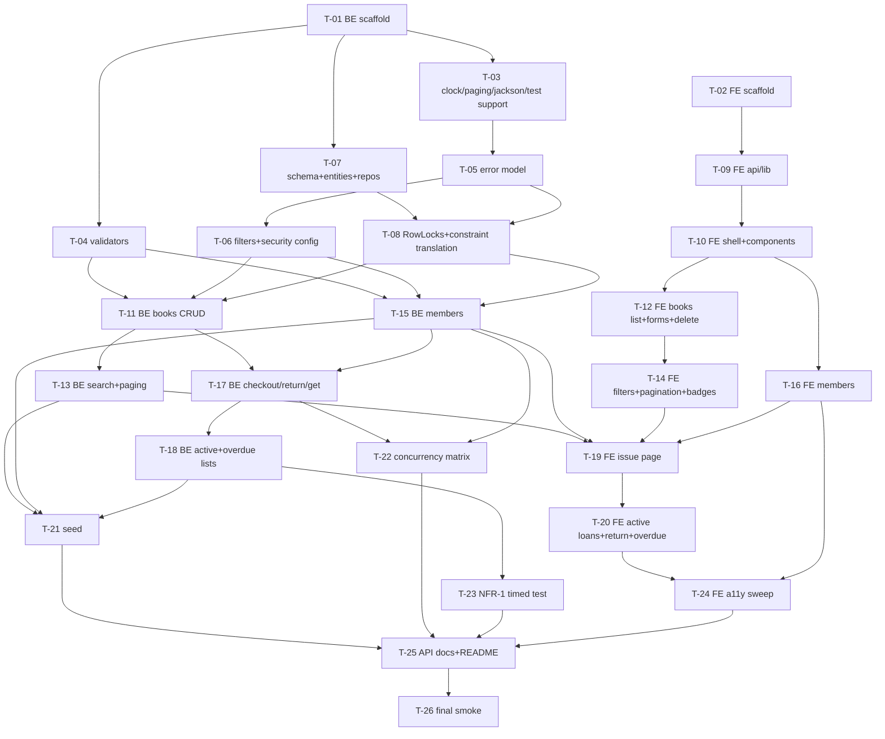

# Implementation Plan

**Status:** approved by user 2026-11-25 (Stage 4 gate passed)
**Owner:** `planning` agent | **Approved by user:** yes (2026-11-25)
**Inputs:** approved `.claude/docs/requirements.md`, `.claude/docs/architecture.md` (incl. [DR-n] changes, ADR-1..31), `.claude/docs/design-review.md`

Conventions: IDs (`FR-n`, `AC-n.BE/FE.m`, `AC-X.n`, `NFR-n`, `DR-n`, `ADR-n`, `R-n`) refer to the approved documents. Plan IDs: tasks `T-nn`, phases `P0..P7`, plan decisions `PD-n`. Size: S <= ~1h, M <= ~half day (no L tasks; large areas are split). Jira: stories AG-24..AG-27, FE sub-tasks AG-28/30/32/34, BE sub-tasks AG-29/31/33/35 (epic AG-23). Architecture is not changed by this plan; no architecture problem was found while planning.

## 1. Approach and conventions

### 1.1 Layout and naming
- Repo root = current project directory, branch `feature`. Code lives only in `backend/` and `frontend/`, plus root `README.md` and `shared-test-vectors/` (PD-1). Never touch `.codemie/` or the app-unrelated root `docs/` folder.
- Backend: Maven module `com.library:library-backend`, base package `com.library`, feature packages `book`, `member`, `loan`, `common/{error,persistence,validation,web,time}`, `seed`, `config` (architecture section 4). Tests mirror main packages. Test class names end `Test` (unit/slice/API) or `IT` is NOT used: one `mvn test` runs everything (NFR-11). Each test method name or `@DisplayName` contains the AC id it proves (e.g. `AC_4_BE_3_noCopyAvailable`).
- Frontend: `frontend/src/{app,api,components,features/{books,members,loans},lib,styles,test}` (architecture 9.1). Test files sit next to the code as `*.test.ts(x)`; names/`describe` blocks contain AC ids.
- Task groups: a "group" = one phase below; each phase leaves both projects building with tests green (`mvn test` and `npm test`, `npm run lint`, `npm run build` all exit 0) before the next phase starts.

### 1.2 Pinned stack (compatible set; exact patch versions are resolved at T-01/T-02, recorded in the task evidence and locked in `pom.xml`/`package-lock.json`)

| Area | Pin | Compatibility note |
|---|---|---|
| Java / Maven | Java 21 (`<java.version>21</java.version>`, `maven.compiler.release=21`); Maven 3.10 | F-6 |
| Spring Boot | `spring-boot-starter-parent` **3.5.x** (latest 3.5 patch on Maven Central at T-01; must be >= 3.2 for `NoResourceFoundException`, DR-6). Fallback if unavailable: 3.4.x | 3.5 supports Java 21, Hibernate 6.6, H2 2.3 via BOM |
| Boot starters | `web`, `validation`, `data-jpa`, `actuator`, `test` (test scope). No devtools, no security | DB driver `com.h2database:h2` (runtime, version from Boot BOM, do not override) |
| springdoc | `org.springdoc:springdoc-openapi-starter-webmvc-ui` **2.8.x** (latest 2.8 patch) | 2.8.x targets Boot 3.4/3.5; verify with `mvn dependency:tree` and a startup that serves `/v3/api-docs` (R-10) |
| Node | Node 24 / npm 11 (F-6); `engines` set in `package.json` | |
| React | `react`, `react-dom` **^19** | |
| TypeScript | **~5.8 or 5.9**, `strict: true` | |
| Vite | **^7** with `@vitejs/plugin-react` **^5** | Vite 7 needs Node >= 20.19 (OK with 24) |
| Routing | `react-router` **^7** (single package; `createBrowserRouter` + `RouterProvider`) | |
| Server state | `@tanstack/react-query` **^5** | |
| Forms | `react-hook-form` **^7** | |
| Test runner | `vitest` **^3.2** (must declare Vite 7 support; a newer Vitest major is allowed only if its peer range includes Vite 7), `jsdom` | `@vitest/coverage` not required |
| Test libs | `@testing-library/react` ^16 + `@testing-library/dom` ^10 + `@testing-library/user-event` ^14 + `@testing-library/jest-dom` ^6; `msw` ^2; `vitest-axe` ^0.1 + `axe-core` ^4 | vitest-axe is lightly maintained: if its matchers do not register under the chosen Vitest, call `axe-core` directly through a 15-line helper in `src/test/axe.ts` (risk RK-6) |
| Lint | `eslint` ^9 (flat config), `typescript-eslint` ^8, `eslint-plugin-react-hooks`, `eslint-plugin-jsx-a11y` ^6, `globals` | `react/no-danger` equivalent via `no-restricted-syntax` on `dangerouslySetInnerHTML` |
| Styling | CSS Modules (built into Vite), `global.css` tokens | no UI library |

Gate for every dependency task: `npm ls` and `mvn dependency:tree` report no unresolved/peer conflicts (no `ERESOLVE`).

### 1.3 Ports, proxy, config
- Backend `127.0.0.1:8080`; Vite `localhost:5173` with `strictPort: true` (a changed port would break the allowlists, R-12).
- `vite.config.ts`: `server.proxy['/api'] = { target: process.env.VITE_API_PROXY_TARGET ?? 'http://127.0.0.1:8080', changeOrigin: false }`; Vite host check left at default (DR-7, DR-16). Swagger UI/`/v3/api-docs`/`/actuator` are reached directly on `:8080`, not via the proxy.
- Backend `application.yml` per architecture 10.4 (all rows). Test `application.yml` overrides: datasource URL `jdbc:h2:mem:${random.uuid};DB_CLOSE_DELAY=-1;LOCK_TIMEOUT=5000`, `library.demo-data.enabled=false` (DR-9).

### 1.4 Commands (derived from the stack)

| Purpose | Command (run from repo root) | Expected |
|---|---|---|
| Backend build + all tests | `cd backend && mvn -B test` | exit 0, 0 failures |
| Backend package | `cd backend && mvn -B package` | exit 0, jar in `backend/target/` |
| Backend single test | `cd backend && mvn -B test -Dtest=ClassName` | exit 0 |
| Backend run | `cd backend && mvn spring-boot:run` | `GET http://127.0.0.1:8080/actuator/health` -> `{"status":"UP"}` |
| Frontend install | `cd frontend && npm install` (first time) / `npm ci` (after lockfile exists) | exit 0 |
| Frontend tests | `cd frontend && npm test` (script `vitest run`) | exit 0 |
| Frontend lint | `cd frontend && npm run lint` | exit 0, no warnings (`--max-warnings 0`) |
| Frontend type-check + build | `cd frontend && npm run build` (`tsc -b && vite build`) | exit 0 |
| Frontend run | `cd frontend && npm run dev` | `http://localhost:5173` loads; `/api/...` proxied |
| Dependency sanity | `cd backend && mvn -B dependency:tree`; `cd frontend && npm ls` | no conflicts |

Windows/PowerShell note: use `;` not `&&` if the shell is PowerShell, or run each command with the working directory set. Commands contain no OS-specific scripts (NFR-10).

### 1.5 Implementation rules that apply to every task
1. Follow architecture section 7.3 locking rules on every write path (lock first, then read; no association navigation before the lock; `RowLocks`; counters only via entity methods called from `LoanService`/seeder). These are review-checklist items (R-3).
2. No `LocalDate.now()`/`Instant.now()` without the injected `Clock` (10.5). No query-parameter values or request bodies in logs (DR-14). No `dangerouslySetInnerHTML`.
3. Each task commits nothing by itself (the PR agent handles git); it must leave the tree building and tests green.
4. Honesty: evidence lists every command run with its exit code; anything not run is reported as not run.

## 2. Phases, parallelism and Jira split

| Phase | Purpose | Tasks | Parallelism inside the phase |
|---|---|---|---|
| P0 | Scaffolding | T-01 (BE), T-02 (FE) | T-01 and T-02 fully parallel |
| P1 | Foundations | BE: T-03, T-04, T-05, T-06, T-07, T-08. FE: T-09, T-10 | BE chain and FE chain parallel; within BE, T-03/T-04/T-07 parallel, then T-05, T-06, T-08; within FE T-09 then T-10 |
| P2 | US-1 catalogue (AG-24) | T-11 (BE, AG-29), T-12 (FE, AG-28) | parallel (FE uses MSW) |
| P3 | US-2 search (AG-25) | T-13 (BE, AG-31), T-14 (FE, AG-30) | parallel; T-13 after T-11, T-14 after T-12 |
| P4 | US-3 members (AG-26) | T-15 (BE, AG-33), T-16 (FE, AG-32) | parallel; also parallel with P3 (no dependency between US-2 and US-3) |
| P5 | US-4 loans (AG-27) | BE: T-17 then T-18 (AG-35). FE: T-19 then T-20 (AG-34) | BE and FE parallel |
| P6 | Cross-cutting hardening | T-21 seed, T-22 concurrency, T-23 NFR-1 timed test, T-24 FE accessibility sweep, T-25 API docs + README | T-21, T-22, T-23, T-24 parallel; T-25 after them |
| P7 | Final integration | T-26 | last |

Suggested BE/FE split per Jira sub-task (one implementation-agent invocation per task; BE and FE tasks of the same story may run as two parallel invocations):

| Story | FE sub-task | FE tasks | BE sub-task | BE tasks |
|---|---|---|---|---|
| US-1 AG-24 | AG-28 | T-12 (+ shared T-09, T-10) | AG-29 | T-11 (+ shared T-03..T-08) |
| US-2 AG-25 | AG-30 | T-14 | AG-31 | T-13 |
| US-3 AG-26 | AG-32 | T-16 | AG-33 | T-15 |
| US-4 AG-27 | AG-34 | T-19, T-20 | AG-35 | T-17, T-18 |
| Cross-cutting (placed in sub-tasks per requirements 11) | AG-28/30/32/34 (AC-X.2, AC-X.3, NFR-3) | T-09, T-10, T-24 | AG-29/31/33/35 (AC-X.1, AC-X.4, NFR-5/6/9/13) | T-03..T-08, T-21, T-22, T-23, T-25 |

### 2.1 Dependency graph

Note: T-19 depends on T-13/T-15 only through the API contract (MSW mocks are used); the edge records that the contract must be implemented before the final smoke, and lets T-19 reuse `useBookQueries`/`useMemberQueries` from T-14/T-16. No cycles.

## 3. Task list

Task block fields: **Deps** = prerequisite tasks; **Refs** = requirement/design IDs satisfied; **Size**; **Priority** (all Must unless noted); **Parallel** = may run alongside. "Verify" gives commands; "DoD" is the checkable definition of done.

### Phase P0 - Scaffolding

#### T-01 Backend scaffold (S-M)
- **Deps:** none. **Parallel:** T-02. **Refs:** C-1, C-3, F-1, F-3, NFR-9, NFR-10, DR-6, DR-9, DR-16.
- **Create:** `backend/pom.xml` (pins per 1.2), `LibraryApplication.java`, `src/main/resources/application.yml` (all architecture 10.4 rows incl. `open-in-view=false`, `ddl-auto=validate`, `sql.init.mode=embedded`, `h2.console.enabled=false`, actuator exposure `health` only, `server.error.*`, `library.*` properties), `ddl-auto=none` and no `schema.sql` until T-07 (T-07 adds `schema.sql` and switches to `validate`), `src/test/resources/application.yml` (unique DB URL, demo off), one smoke test.
- **DoD:** `mvn -B test` exit 0; app starts and `/actuator/health` returns `{"status":"UP"}` on `127.0.0.1:8080`; `mvn dependency:tree` shows Boot >= 3.2 and springdoc 2.8.x with no conflicts; resolved versions recorded in evidence.
- **Tests:** `LibraryApplicationTest` (`@SpringBootTest` context loads; health UP via MockMvc).
- **Verify:** `cd backend && mvn -B test`; `mvn -B dependency:tree`; `mvn spring-boot:run` then GET health.

#### T-02 Frontend scaffold (M)
- **Deps:** none. **Parallel:** T-01. **Refs:** C-2, F-2, D4, D5, D7, NFR-3, NFR-10, DR-16, DR-7.
- **Create:** `frontend/package.json` (scripts `dev`, `build`=`tsc -b && vite build`, `test`=`vitest run`, `lint`=`eslint . --max-warnings 0`, `preview`), `index.html`, `vite.config.ts` (proxy per 1.3, `strictPort`, vitest block: jsdom, globals false, `setupFiles`, `css.modules` default), `tsconfig*.json` (strict), `eslint.config.js` (ts, react-hooks, jsx-a11y recommended, no `dangerouslySetInnerHTML`), `src/main.tsx` placeholder app, `src/test/setup.ts` (jest-dom, MSW server start/reset/close with `onUnhandledRequest: 'error'`, `HTMLDialogElement.showModal/close` polyfill for jsdom, `matchMedia` stub if needed), `src/test/handlers.ts` (empty list), `src/test/axe.ts` (vitest-axe or direct axe-core helper), `src/test/render.tsx` (renders with fresh `QueryClient` (retry per app policy), `MemoryRouter`/`createMemoryRouter`), one smoke test.
- **DoD:** `npm test`, `npm run lint`, `npm run build` exit 0; `npm run dev` serves on 5173; a Vitest smoke test using MSW and an axe check passes; `npm ls` clean; proxy config readable from `vite.config.ts` (test asserts the exported proxy target default is `http://127.0.0.1:8080` and `changeOrigin === false`).
- **Tests:** `App.smoke.test.tsx`, `vite.config.test.ts`.
- **Verify:** `cd frontend && npm install && npm test && npm run lint && npm run build`.

### Phase P1 - Foundations

#### T-03 Backend cross-cutting basics: clock, paging, Jackson, test support (S-M)
- **Deps:** T-01. **Parallel:** T-04, T-07. **Refs:** NFR-11, NFR-12, ADR-11, ADR-12, ADR-21, AC-2.BE.3, DR-9, DR-15.
- **Create:** `common/time/ClockConfig`; `common/web/PageResponse<T>` and `PageRequestParams` (page >= 0, 1 <= size <= 100, defaults 0/20, validated explicitly, not Spring's clamping resolver; produces a field-error exception once T-05 exists, so this task defines `ValidationException` placeholder shape only if T-05 is not yet done - otherwise T-05 wires it; see T-05); `config/JacksonConfig` (ISO dates, `ACCEPT_FLOAT_AS_INT` disabled, scalar coercion disabled, fail on trailing tokens); test support in `src/test/java/com/library/support/`: `TestClockConfig` (mutable fixed `Clock`), `ApiRequests` (MockMvc builder adding `Host: localhost:8080` and, for non-GET/HEAD/OPTIONS, `X-Requested-With: library-ui`), `TestData` factory helpers.
- **DoD:** `PageRequestParams` rejects `size=101`, `size=0`, `page=-1`, `size=abc` (unit test, exception carries field name); Jackson rejects `2.5` and `"5"` for an `int` field (unit test with `ObjectMapper` from context); fixed clock overrides the bean in a test slice.
- **Tests:** `PageRequestParamsTest`, `JacksonStrictTypingTest` (AC-1.BE.2 whole-number), `ClockConfigTest`.
- **Verify:** `cd backend && mvn -B test`.

#### T-04 Validation and normalisation + shared vectors (M)
- **Deps:** T-01. **Parallel:** T-03, T-07, T-09. **Refs:** FR-5, FR-11, AC-1.BE.3, AC-3.BE.2, AC-2.BE.1 (ISBN filter normalisation), ADR-22, DR-15, R-4.
- **Create:** `common/validation/{Isbn, IsbnValidator, IsbnNormalizer, LibraryEmail, LibraryEmailValidator}`; `shared-test-vectors/isbn.json` (valid/invalid ISBN-10/13 incl. hyphens, spaces, lower-case `x`, bad check digit, wrong length, the pair `0306406152` / `9780306406157`) and `shared-test-vectors/email.json` (valid/invalid incl. two `@`, empty local part, no dot in domain, spaces, > 254 chars); `pom.xml` test resource entry so backend tests read `../shared-test-vectors`.
- **DoD:** validators pass every vector; normaliser strips hyphens/spaces, upper-cases trailing `x`, does NOT convert ISBN-10 to ISBN-13; email lower-casing uses `Locale.ROOT` (test under `Locale.setDefault(new Locale("tr","TR"))`); trimming helper documented for request records (applied in T-11/T-15).
- **Tests:** `IsbnValidatorTest`, `IsbnNormalizerTest`, `LibraryEmailValidatorTest` (parameterised from the shared JSON), `LocaleSafeNormalizationTest` (DR-15).
- **Verify:** `cd backend && mvn -B test -Dtest='Isbn*Test,LibraryEmail*Test,LocaleSafe*Test'`.

#### T-05 Error model and producers (M)
- **Deps:** T-03. **Parallel:** T-07. **Refs:** FR-22, AC-X.1, NFR-9, ADR-10, ADR-26, DR-3, DR-6, architecture 6.2, 10.2.
- **Create:** `common/error/{ErrorCode (every code in 6.2 incl. FORBIDDEN_ORIGIN, REQUEST_REJECTED, MALFORMED_REQUEST, NOT_FOUND, CONCURRENT_UPDATE), ApiError, FieldErrorDto, NotFoundException, ConflictException, ValidationException, GlobalExceptionHandler, ApiErrorWriter, ApiErrorController}`. `GlobalExceptionHandler` handles every type listed in 10.2 (`MethodArgumentNotValid`, `HandlerMethodValidation`, `ConstraintViolation`, `HttpMessageNotReadable` with JSON-path field mapping, `MethodArgumentTypeMismatch`, `NoResourceFound`, method-not-supported, media-type-not-supported, `Pessimistic`/`OptimisticLockingFailure` -> 409 `CONCURRENT_UPDATE` logged WARN for optimistic, untranslated `DataIntegrityViolation` -> 500, `Exception` -> 500). `fieldErrors` always present, sorted by field then message. `ApiErrorController` replaces `BasicErrorController` with status->code mapping (400 `MALFORMED_REQUEST`, 404 `NOT_FOUND`, 405, 415, other 4xx `REQUEST_REJECTED`, 5xx `INTERNAL_ERROR`). `server.error.whitelabel.enabled=false`. Wire `PageRequestParams` failures to a 400 field error. Log levels per 10.3 (409/400 INFO with code and ids, 404 DEBUG, 500 ERROR with stack in log only).
- **DoD:** a throw-away test controller (test source set only) exercises every handler and every response has exactly `status, code, message, timestamp (ISO with offset), fieldErrors`; no stack trace/class name/SQL/constraint name in any body; unknown route -> 404 `NOT_FOUND`; malformed JSON -> 400 `MALFORMED_REQUEST`; `POST` with `text/plain` -> 415; wrong method -> 405; forwarding to `/error` with status 400/404/405/415/418/500 yields the mapped code; timestamp comes from the injected `Clock`.
- **Tests:** `GlobalExceptionHandlerTest` (MockMvc + test controller), `ApiErrorControllerTest`, `ApiErrorWriterTest`, `ErrorBodyShapeTest` (AC-X.1).
- **Verify:** `cd backend && mvn -B test -Dtest='*Error*Test,GlobalExceptionHandlerTest'`.

#### T-06 Request filters and security config (M)
- **Deps:** T-05. **Parallel:** T-08. **Refs:** NFR-6, NFR-9, AC-X.1, ADR-27, DR-6, DR-7, DR-14, DR-17, R-12.
- **Create:** `common/web/RequiredHeaderFilter` (order: Host allowlist for every request -> 403 `FORBIDDEN_ORIGIN`; Origin allowlist on non-GET/HEAD/OPTIONS when `Origin` present -> 403 `FORBIDDEN_ORIGIN`; `X-Requested-With: library-ui` required on non-GET/HEAD/OPTIONS -> 403 `MISSING_REQUIRED_HEADER`; bodies via `ApiErrorWriter`), `RequestLoggingFilter` (one INFO line: method, path, query-parameter names only, status, duration; optional `X-Request-Id` in MDC/response), `@ConfigurationProperties` for `library.security.allowed-hosts` / `allowed-origins` (defaults from 10.4; the 403 message names the config property as the likely cause, R-12). Filters registered with explicit order (header filter before logging does not matter, but both before MVC). `/actuator/health` and `/error` dispatches pass through the Host check (health works with `Host: 127.0.0.1:8080`).
- **DoD:** all rows of the DR-7/DR-17 matrix pass in tests: allowed Host + no Origin write -> passes filter; bad Host GET -> 403 `FORBIDDEN_ORIGIN`; bad Origin POST -> 403 `FORBIDDEN_ORIGIN`; missing header on POST/PUT/DELETE/PATCH -> 403 `MISSING_REQUIRED_HEADER`; `OPTIONS`/`GET`/`HEAD` need no header; allowlist overridable by property; log capture (Logback `ListAppender`) shows parameter names but never a value or body (AC-X.1, DR-14).
- **Tests:** `RequiredHeaderFilterTest`, `RequestLoggingFilterTest`, `SecurityPropertiesTest`.
- **Verify:** `cd backend && mvn -B test -Dtest='RequiredHeaderFilterTest,RequestLoggingFilterTest,SecurityPropertiesTest'`.

#### T-07 Schema, entities, repositories (M)
- **Deps:** T-01. **Parallel:** T-03, T-04, T-05. **Refs:** D1, D2, D3, ADR-6..9, ADR-23, DR-1, DR-2, DR-3, DR-8 (mapping), architecture 5.1-5.2.
- **Create:** `src/main/resources/schema.sql` exactly per 5.2 (tables `book`, `member`, `loan`; named constraints `uk_book_isbn`, `ck_book_total_copies`, `ck_book_active_loans`, `uk_member_email`, `ck_member_status`, `ck_member_active_loans`, `ck_member_inactive_no_loans`, `fk_loan_member`, `fk_loan_book`, `ck_loan_due`, `ck_loan_return`, `ck_loan_active_key`, `uk_loan_member_active_book`; `version BIGINT NOT NULL DEFAULT 0` on `book` and `member`; indexes `ix_book_title_isbn`, `ix_member_name_id`, `ix_member_status`, `ix_loan_member_active`, `ix_loan_book_active`, `ix_loan_overdue`); entities `Book`, `Member` (`@Version`, `email_normalized` set via `toLowerCase(Locale.ROOT)` on persist/update, counter methods `lendCopy/returnCopy/startLoan/endLoan` as the only counter mutators, optional `@DynamicUpdate`), `MemberStatus`, `Loan` (`@ManyToOne(fetch = LAZY, optional = false)` for member and book, `activeBookId` maintained with `returnDate`), `Availability` enum, `LoanPolicy` (14 days, max 3); repositories `BookRepository`, `MemberRepository`, `LoanRepository` (skeletons: derived finders needed later are added in the owning task). Switch to `ddl-auto=validate` for real (remove any T-01 placeholder).
- **DoD:** context starts with `validate` against `schema.sql`; every constraint above fires in a `@DataJpaTest` (`@AutoConfigureTestDatabase(replace = NONE)`, unique-DB URL): duplicate ISBN, total copies 0/1000, `active_loan_count > total_copies`, negative count, member count 4, inactive member with count 1, duplicate active (member, book) loan, second NULL `active_book_id` allowed, `ck_loan_active_key` violations, FK delete of a book that has loans; two Spring contexts in one JVM start without interfering (DR-9).
- **Tests:** `SchemaConstraintsTest` (names compared case-insensitively against the exception text), `EntityMappingTest` (LAZY associations: reading `loan.getBook().getId()` does not initialise the proxy; `@Version` increments), `TestDatabaseIsolationTest`.
- **Verify:** `cd backend && mvn -B test -Dtest='SchemaConstraintsTest,EntityMappingTest,TestDatabaseIsolationTest'`.

#### T-08 RowLocks and constraint translation (M)
- **Deps:** T-05, T-07. **Parallel:** T-06. **Refs:** AC-4.BE.11, NFR-5, ADR-24, ADR-25, DR-1, DR-2, DR-5, architecture 6.2.1, 7.3.
- **Create:** `common/persistence/RowLocks` (`lock(Class<T>, id)`: `find(..., PESSIMISTIC_WRITE)`; if the entity was already managed, `refresh(entity, PESSIMISTIC_WRITE)`; throws the type-specific `NotFoundException` (`BOOK_NOT_FOUND`/`MEMBER_NOT_FOUND`/`LOAN_NOT_FOUND`)); `common/error/ConstraintViolationTranslator` with a `translate(Operation, DataIntegrityViolationException)` API and an `Operation` enum (`CREATE_BOOK`, `UPDATE_BOOK`, `DELETE_BOOK`, `REGISTER_MEMBER`, `EDIT_MEMBER`, `DEACTIVATE_MEMBER`, `CHECKOUT`, `RETURN`, ...), reading the constraint name from Hibernate's `ConstraintViolationException` with the H2 message as fallback, case-insensitive, implementing every row of 6.2.1, unknown pair -> 500 `INTERNAL_ERROR` logged at ERROR with the constraint name (never returned).
- **DoD:** table-driven test asserts each row of 6.2.1 (constraint x operation -> HTTP/code/fieldErrors) by provoking the real constraint against H2; `RowLocks` returns post-lock state: a test with two threads where thread B waits on a lock held by A, A commits a counter change, and B's returned entity shows the committed value (also the already-managed -> `refresh` path); lock of a missing id throws the right `NotFoundException`.
- **Tests:** `ConstraintViolationTranslatorTest`, `RowLocksTest` (two-thread, non-transactional, own context data cleanup).
- **Verify:** `cd backend && mvn -B test -Dtest='ConstraintViolationTranslatorTest,RowLocksTest'`.

#### T-09 Frontend API layer and library code (M)
- **Deps:** T-02. **Parallel:** T-04, T-07. **Refs:** AC-X.3, AC-1.FE.2, AC-3.FE.2, FR-5, FR-11, NFR-12, ADR-31, DR-10, DR-19, R-4.
- **Create:** `src/api/http.ts` (base `/api`, JSON, `X-Requested-With: library-ui` on all methods except GET/HEAD/OPTIONS, reads error body as text and accepts only JSON with `status`, `code`, `message`; any other non-2xx or a rejected `fetch` -> `ApiError('BACKEND_UNAVAILABLE')`), `src/api/types.ts` (BookResponse, MemberResponse, LoanResponse, OverdueLoanResponse, PageResponse<T>, ApiErrorBody, request types), `src/api/queryKeys.ts`, `src/api/{books,members,loans}.ts` typed functions (all endpoints in 6.3 used by the UI, query strings built from filter objects, empty values omitted), `src/lib/validators.ts` (ISBN normalise + checksum, email rule from AC-3.BE.2, length checks), `src/lib/errorMessages.ts` (every code in 6.2 -> plain language; `BACKEND_UNAVAILABLE` text per 9.3; fallback to server `message`), `src/lib/dates.ts` (parse `yyyy-MM-dd` as local date, `Intl.DateTimeFormat`), `src/lib/useDebouncedValue.ts` (~300 ms), `src/lib/queryClient.ts` (retry once only for `BACKEND_UNAVAILABLE`/5xx; mutations never retried; exported `retryPolicy` for tests).
- **DoD:** validators pass the same `shared-test-vectors/*.json` files as the backend (imported by relative path `../../shared-test-vectors`; `vite`/`tsconfig` allow it); MSW tests prove: 500 with text body and 502 with empty body -> `BACKEND_UNAVAILABLE`; network error -> `BACKEND_UNAVAILABLE`; 400 with valid ApiError JSON keeps `fieldErrors`; 4xx not retried; write requests carry the header, GETs do not; `dates.ts` does not shift a day (test with `TZ` set to a negative-offset zone via `vi.stubEnv`/process TZ in the test script).
- **Tests:** `http.test.ts`, `validators.test.ts` (shared vectors), `errorMessages.test.ts` (every `ErrorCode` string has a message), `dates.test.ts`, `queryClient.test.ts`, `useDebouncedValue.test.ts`.
- **Verify:** `cd frontend && npm test && npm run lint && npm run build`.

#### T-10 Frontend shell, shared components, accessibility base (M)
- **Deps:** T-09. **Refs:** FR-23, AC-X.2, AC-X.3, NFR-3, NFR-4, NFR-8, NFR-2, DR-11, architecture 9.1, 9.2, 9.4.
- **Create:** `src/styles/global.css` (colour tokens, `:focus-visible` outline >= 2 px, >= 768 px layout, no outline removal), `src/styles/contrast.test.ts` (parses token pairs from a tokens module `src/styles/tokens.ts` exported for both CSS generation and the test; text pairs >= 4.5:1, focus/border >= 3:1), `src/app/{AppLayout, routes, NotFoundPage, RouteErrorBoundary}.tsx` (skip link, header, `<nav aria-label>` with NavLinks "Books", "Members", "Issue & Return", "Overdue" with `aria-current="page"`, `<main>`; routes per 9.2 with placeholder pages until each story lands; `/` redirects to `/books`; `*` -> NotFound), `src/components/{FormField, ConfirmDialog, Pagination, StatusBadge, LoadingState, EmptyState, ErrorState, Notice}.tsx` with CSS Modules, `src/lib/{usePageTitle, useRouteFocus}.ts`, `NotificationProvider` (success notices in `role="status"`), `src/main.tsx` wiring (`QueryClientProvider`, `RouterProvider`, `NotificationProvider`).
- **DoD:** nav reachable and operable by keyboard with `aria-current`; every route sets its `document.title` (list in 9.2) and moves focus to the `<h1>` (`tabIndex=-1`) on navigation; `ConfirmDialog` uses native `<dialog>.showModal()`, Esc cancels, focus returns to the trigger only if it still exists; `FormField` associates label, error (`aria-describedby`) and `aria-invalid`; `StatusBadge` conveys state in text; `ErrorState` shows the friendly message with a Retry button that calls `refetch`; `RouteErrorBoundary` renders a fallback with retry on a render error; contrast test passes; axe: no violations on layout + each component story rendered in a test.
- **Tests:** `AppLayout.test.tsx` (AC-X.2, titles, focus), `ConfirmDialog.test.tsx`, `FormField.test.tsx`, `Pagination.test.tsx`, `StatusBadge.test.tsx`, `ErrorState.test.tsx`/`RouteErrorBoundary.test.tsx` (AC-X.3), `contrast.test.ts` (NFR-3, DR-11).
- **Verify:** `cd frontend && npm test && npm run lint && npm run build`.

**P1 exit gate:** `cd backend && mvn -B test` and `cd frontend && npm test && npm run lint && npm run build` all exit 0.

### Phase P2 - US-1 Manage the book catalogue (AG-24)

#### T-11 Books CRUD backend (AG-29) (M)
- **Deps:** T-04, T-06, T-08. **Parallel:** T-12, T-15. **Refs:** FR-1..FR-6, AC-1.BE.1..8, AC-X.1, DR-1, DR-12, DR-15, ADR-22, ADR-24.
- **Create:** `book/{BookController, BookService}`, `book/dto/{BookRequest (compact constructor trims, null-safe; `@NotBlank @Size(max=255)` title/author, `@Isbn`, `@NotNull @Min(1) @Max(999)` totalCopies as `Integer`), BookResponse (availableCopies = total - active)}`, `BookRepository` finders (`findByIsbn`, existence excluding self), `LoanRepository.deleteReturnedByBookId` (bulk `DELETE FROM loan WHERE book_id = ? AND return_date IS NOT NULL`). Endpoints `POST /api/books` (201 + `Location`), `GET /api/books/{id}`, `PUT /api/books/{id}`, `DELETE /api/books/{id}` (204). `BookService`: services own `@Transactional`; update/delete take the book lock via `RowLocks` before reading state; update rejects `totalCopies < activeLoanCount` with `TOTAL_COPIES_BELOW_ACTIVE_LOANS` + `fieldErrors[totalCopies]`; delete order = lock, check `activeLoanCount == 0` (`BOOK_HAS_ACTIVE_LOANS`), bulk delete returned loans, delete book; each method flushes and translates `DataIntegrityViolationException` via `ConstraintViolationTranslator` with its operation (DR-5). A stub `GET /api/books` returning page 0 unfiltered is NOT part of this task (T-13).
- **DoD:** every AC-1.BE.x passes via MockMvc: create returns generated id and available = total (AC-1.BE.1); blank/missing fields, total 0/1000/2.5/"5"/null, title > 255 give 400 listing each offending field and store nothing (AC-1.BE.2); invalid ISBN checksum -> `fieldErrors[isbn]` (AC-1.BE.3); duplicate normalised ISBN (hyphenated vs plain) -> 409 `ISBN_ALREADY_EXISTS` with `fieldErrors[isbn]`, own-ISBN update succeeds, ISBN-10 and its ISBN-13 equivalent both storable (AC-1.BE.4, Q-A1); get/update/delete unknown id -> 404 `BOOK_NOT_FOUND` (AC-1.BE.5); update below active loans -> 400 and above -> 200 with recalculated available (AC-1.BE.6); delete with active loan -> 409 and book remains (AC-1.BE.7); delete with only returned loans -> 204, loans gone, later GET 404 (AC-1.BE.8); whitespace-padded 255-char title is accepted (DR-15); an `ISBN` race (two parallel creates, same ISBN) yields one 201 and one 409 via `uk_book_isbn`.
- **Tests:** `BookApiTest` (one test per AC id, includes AC-X.1 body shape on 400/404/409), `BookServiceTest` (locking order/`RowLocks` use via spy for update and delete, DR-12 delete sequence), `BookRequestTest` (trim before validation).
- **Verify:** `cd backend && mvn -B test -Dtest='Book*Test'` then `mvn -B test`.

#### T-12 Books list page, forms, delete (AG-28) (M)
- **Deps:** T-10. **Parallel:** T-11, T-13, T-15, T-16. **Refs:** FR-1..FR-6, AC-1.FE.1..7, AC-X.3, NFR-6 (XSS), NFR-8, DR-11, DR-19.
- **Create:** `features/books/{BooksPage, BookTable, BookFormPage, BookForm, useBookQueries}`; `routes.tsx` entries `/books`, `/books/new`, `/books/:id/edit`; MSW handlers + fixtures `src/test/handlers/books.ts`. BooksPage in this task: loading/error+Retry/empty-catalogue state with "Add book" (AC-1.FE.7), table with caption, title, author, ISBN, total, available (plain count; the badge and filters arrive in T-14), Edit/Delete actions; delete via `ConfirmDialog` (cancel leaves untouched, confirm deletes, refreshes list through query invalidation of `books`, success notice, focus moves to the notice per DR-11); 409 `BOOK_HAS_ACTIVE_LOANS` -> clear message, row stays (AC-1.FE.5). Form: React Hook Form with client validators (required, <= 255, total 1..999 integer, ISBN checksum) blocking submit with inline errors via `FormField` (AC-1.FE.2); on server 400/409 apply `fieldErrors` with `setError`, focus first invalid field, keep entered values (AC-1.FE.3), form-level message when no field; on success navigate to `/books` with a success notice (AC-1.FE.6); edit page loads the book (404 -> not-retried error state with link back, DR-19).
- **DoD:** all AC-1.FE.1..7 tests pass; a title `` renders as text; axe reports no violations on list, empty, form-with-errors and dialog-open states; `document.title` per route.
- **Tests:** `BooksPage.test.tsx` (AC-1.FE.1, 4, 5, 6, 7 + loading/error/retry), `BookForm.test.tsx` (AC-1.FE.2, 3 incl. no request sent on client error, values preserved, duplicate ISBN inline), `BooksPage.xss.test.tsx` (NFR-6), axe assertions in each.
- **Verify:** `cd frontend && npm test && npm run lint && npm run build`.

### Phase P3 - US-2 Search and browse (AG-25)

#### T-13 Catalogue search and pagination backend (AG-31) (M)
- **Deps:** T-11. **Parallel:** T-14, T-15, T-16. **Refs:** FR-7, FR-8, FR-9, AC-2.BE.1..6, NFR-1, DR-18, ADR-11.
- **Create:** `GET /api/books` in `BookController`; `BookSearchCriteria`; query via JPA Specification or JPQL with bind parameters: case-insensitive "contains" on title/author, ISBN filter normalised then "contains", `%`/`_`/escape char in input escaped in `LIKE`, availability `available` (`total_copies - active_loan_count >= 1`) / `unavailable` (`= 0`), filters AND-combined, order `lower(title)` then `isbn`; explicit `PageRequestParams`; `PageResponse` envelope; text filters max 255 and bad enum -> 400 field error (DR-18); unknown query params ignored.
- **DoD:** AC-2.BE.1 (each filter alone, combined, hyphenated ISBN filter, `%` literal does not match everything), AC-2.BE.2 (available/unavailable/absent), AC-2.BE.3 (page, size, totals, size 101/0/-1 page -> 400 with field error on `page`/`size`), AC-2.BE.4 (stable order with equal titles and mixed case), AC-2.BE.5 (empty page 200 with `totalElements 0`, `totalPages 0`), AC-2.BE.6 (`totalCopies`, `availableCopies` present), `title` of 256 chars -> 400.
- **Tests:** `BookSearchRepositoryTest` (`@DataJpaTest`, no-N+1 not applicable), `BookSearchApiTest` (names carry AC ids).
- **Verify:** `cd backend && mvn -B test -Dtest='BookSearch*Test'`.

#### T-14 Books filters, pagination, availability badges (AG-30) (M)
- **Deps:** T-12. **Parallel:** T-13, T-15, T-16. **Refs:** FR-7..FR-9, AC-2.FE.1..6, NFR-2, NFR-3, DR-11, ADR-14.
- **Create:** `features/books/BookFilters` (title, author, ISBN inputs, availability select All / Available / All copies out; explicit submit and ~300 ms debounce; "Clear filters"), URL query-string state for filters and page (`/books?title=...&availability=available&page=2`), match count in a `role="status"` region (AC-2.FE.2), `StatusBadge` in the table ("Available (2)" / "All copies out", text + shape), `Pagination` keeping filters (AC-2.FE.4), "No books found" with Clear filters vs empty catalogue (distinguished by whether filters are applied, AC-2.FE.5 vs AC-1.FE.7), page reset to 0 on filter change, reloading the URL restores state.
- **DoD:** AC-2.FE.1..6 tests pass; typing triggers one request after the debounce (fake timers; request count asserted); Back button restores previous filters; badge text present without relying on colour; axe clean on filtered/no-match/paginated states.
- **Tests:** `BookFilters.test.tsx`, `BooksPage.search.test.tsx` (AC-2.FE.x), `BookTable.badge.test.tsx`.
- **Verify:** `cd frontend && npm test && npm run lint && npm run build`.

### Phase P4 - US-3 Manage members (AG-26)

#### T-15 Members backend (AG-33) (M)
- **Deps:** T-04, T-06, T-08. **Parallel:** T-11, T-12, T-13, T-14, T-16. **Refs:** FR-10..FR-14, AC-3.BE.1..8, D9, ADR-19, DR-1, DR-15, DR-18, AC-X.1.
- **Create:** `member/{MemberController, MemberService}`, `member/dto/{MemberRequest (trim in compact constructor; `@NotBlank @Size(max=100)` name, `@NotBlank @Size(max=254) @LibraryEmail` email), MemberResponse}`, `MemberRepository` finders (normalised email lookup excluding self, search spec). Endpoints `POST /api/members` (201, `ACTIVE`), `GET /api/members/{id}`, `PUT /api/members/{id}`, `POST /api/members/{id}/deactivate`, `POST /api/members/{id}/reactivate` (both idempotent), `GET /api/members?status=&search=&page=&size=` (order `lower(name)`, then id; `search` case-insensitive contains on name or email with LIKE escaping, <= 254 chars, `status` enum validated). Edit, deactivate, reactivate take the member lock via `RowLocks` first (DR-1); uniqueness lookups only after the lock; deactivate with `activeLoanCount > 0` -> 409 `MEMBER_HAS_ACTIVE_LOANS`; email stored as entered (trimmed) with `email_normalized = toLowerCase(Locale.ROOT)`; flush + per-operation translation.
- **DoD:** AC-3.BE.1 (201 `ACTIVE`, id), 3.BE.2 (blank name/email, name 101, malformed emails from the shared vectors, email 255 -> 400 listing each field), 3.BE.3 (case-insensitive duplicate on register and on edit -> 409 + `fieldErrors[email]`; own email succeeds), 3.BE.4 (edit stored; unknown id 404 on get/update/deactivate/reactivate), 3.BE.5, 3.BE.6 (member with an active loan inserted via repository fixture stays ACTIVE), 3.BE.7 and idempotency (D9), 3.BE.8 (pagination envelope, order, status filter, `search`, page/size validation), Turkish-locale default does not break `I`/`i` uniqueness (DR-15).
- **Tests:** `MemberApiTest` (AC ids), `MemberServiceTest` (lock-first order), `MemberSearchRepositoryTest`.
- **Verify:** `cd backend && mvn -B test -Dtest='Member*Test'`.

#### T-16 Members frontend (AG-32) (M)
- **Deps:** T-10. **Parallel:** T-11..T-15. **Refs:** FR-10..FR-14, AC-3.FE.1..6, AC-X.3, NFR-8, DR-11.
- **Create:** `features/members/{MembersPage, MemberTable, MemberFormPage, MemberForm, useMemberQueries}`, routes `/members`, `/members/new`, `/members/:id/edit`, MSW handlers/fixtures. Status filter (All/Active/Inactive) in the URL, table with name, email, status label (text "Active"/"Inactive" + shape), Edit, Deactivate or Reactivate, pagination, match count in `role="status"`, empty/loading/error states; deactivate through `ConfirmDialog` (cancel changes nothing; 409 `MEMBER_HAS_ACTIVE_LOANS` -> clear message, member stays Active); reactivate action for inactive members; form with inline client errors (name 1..100, email rule) and server `fieldErrors` (duplicate email inline, values preserved), success notice, focus management.
- **DoD:** AC-3.FE.1..6 tests pass incl. XSS render-as-text for a `<script>` member name, axe clean, titles set.
- **Tests:** `MembersPage.test.tsx` (AC-3.FE.1, 3, 4, 5, 6), `MemberForm.test.tsx` (AC-3.FE.2).
- **Verify:** `cd frontend && npm test && npm run lint && npm run build`.

### Phase P5 - US-4 Borrow and return (AG-27)

#### T-17 Checkout, return, loan-by-id backend (AG-35) (M)
- **Deps:** T-11, T-15. **Parallel:** T-19, T-20. **Refs:** FR-15..FR-19, FR-21 (consistency), AC-4.BE.1..8, AC-4.BE.11 (rules), NFR-5, NFR-12, ADR-8, ADR-9, ADR-24, ADR-28, DR-2, DR-3, DR-13, DR-5.
- **Create:** `loan/{LoanController, LoanService, dto/{CheckoutRequest (`memberId`,`bookId` required, >= 1), LoanResponse}}`. `POST /api/loans`: lock member then book via `RowLocks`; check order exactly 404 member, 404 book, `MEMBER_INACTIVE`, `DUPLICATE_ACTIVE_LOAN`, `LOAN_LIMIT_REACHED`, `NO_COPY_AVAILABLE`; create loan with `checkoutDate = LocalDate.now(clock)`, `dueDate = +14`, `activeBookId = bookId`; `member.startLoan()`, `book.lendCopy()`; flush and translate constraint violations per operation `CHECKOUT`; 201 + `Location: /api/loans/{id}`. `POST /api/loans/{id}/return`: lock loan, read member/book ids from the lazy references without initialising them, lock member then book (`RowLocks`), `LOAN_ALREADY_RETURNED` if `returnDate` set (checked after the loan lock), set `returnDate = today`, `activeBookId = null`, `endLoan()`/`returnCopy()`, flush. `GET /api/loans/{id:\d+}` (active or returned; `overdue`/`daysOverdue` computed server-side for active loans only; 404 `LOAN_NOT_FOUND`; non-numeric id -> 400). Logging of rejections per 10.3. `LoanResponse` built by a fetch-join query (single-loan variant).
- **DoD:** fixed clock tests: due = checkout + 14 and counts change (AC-4.BE.1); 4th loan rejected `LOAN_LIMIT_REACHED` with nothing changed (4.BE.2); no copy -> `NO_COPY_AVAILABLE` (4.BE.3); inactive -> `MEMBER_INACTIVE` (4.BE.4); duplicate -> `DUPLICATE_ACTIVE_LOAN` (4.BE.5); unknown member/book -> 404 with right code (4.BE.6); return sets today and restores copy even when overdue, no fine (4.BE.7); second return -> 409 `LOAN_ALREADY_RETURNED`, unknown -> 404 `LOAN_NOT_FOUND`, counts unchanged (4.BE.8); multi-rule failure returns the first code in the fixed order; `Location` header resolves to `GET /api/loans/{id}` (DR-13); a forced stale write (test hook that bumps `version` in a second transaction) returns 409 `CONCURRENT_UPDATE` (DR-3); backstop mapping: with locking bypassed in a test (direct repository write), a counter violation maps per 6.2.1 (`NO_COPY_AVAILABLE`, `LOAN_LIMIT_REACHED`, `DUPLICATE_ACTIVE_LOAN`); no `Loan.member`/`Loan.book` proxy initialised before its lock (assert with Hibernate statistics: statement order in `returnLoan`).
- **Tests:** `LoanCheckoutApiTest`, `LoanReturnApiTest`, `LoanGetApiTest`, `LoanServiceLockOrderTest` (member before book; loan first on return), `LoanBackstopTranslationTest`.
- **Verify:** `cd backend && mvn -B test -Dtest='Loan*Test'`.

#### T-18 Active and overdue loan lists backend (AG-35) (M)
- **Deps:** T-17. **Parallel:** T-19, T-20. **Refs:** FR-20, FR-21, AC-4.BE.9, AC-4.BE.10, NFR-1, ADR-29, DR-8, DR-18.
- **Create:** `GET /api/loans/active?memberId=&bookId=&page=&size=` (ids >= 1 else 400, order `dueDate` then id, paginated envelope) and `GET /api/loans/overdue` (JSON array of `OverdueLoanResponse`, `dueDate < today` strictly, active only, `daysOverdue = today - dueDate`, order `dueDate` asc then id, unpaginated); dedicated JPQL `JOIN FETCH l.member JOIN FETCH l.book` queries (+ separate count query for the paged one); `LoanResponse.overdue/daysOverdue` computed from `Clock`; routes `/active` and `/overdue` do not collide with `/{id:\d+}`.
- **DoD:** AC-4.BE.9 with fixed clock: due today excluded, due yesterday included with `daysOverdue 1`, returned excluded, ordering most overdue first, fields id/member(id,name)/book(id,title,isbn)/dates/days; AC-4.BE.10 filters by member, by book, both, pagination totals, invalid `memberId=0` -> 400; statement-count test with Hibernate `Statistics` shows the number of SQL statements for 50 loans is constant (<= 2 for paged list incl. count, 1 for overdue), proving no N+1 (DR-8).
- **Tests:** `LoanListsApiTest`, `LoanListQueryStatementCountTest`, `OverdueBoundaryTest` (AC-4.BE.9 due-today edge).
- **Verify:** `cd backend && mvn -B test -Dtest='Loan*Test,Overdue*Test'`; then `mvn -B test`.

#### T-19 Issue and Return screen: pickers and checkout (AG-34) (M)
- **Deps:** T-14, T-16 (reuses query hooks, `StatusBadge`, filters code); T-13 and T-15 for the API contract (MSW fixtures must match the real response shapes). **Parallel:** T-17, T-18. **Refs:** FR-15..FR-18, AC-4.FE.1..3, AC-X.3, NFR-3, NFR-8, ADR-20, DR-11, DR-19.
- **Create:** `features/loans/{IssueReturnPage, MemberPicker, BookPicker, CheckoutResult, useLoanQueries}`, route `/loans`, MSW handlers. Pickers = labelled search input + `fieldset`/legend radio list (not a combobox); MemberPicker queries `GET /api/members?status=ACTIVE&search=`, BookPicker queries `GET /api/books?title=` and shows availability badges; both show "Showing 20 of N - refine your search" when there are more matches and announce result counts in `role="status"`; selected item echoed as text. Checkout button disabled until both selected; success -> `CheckoutResult` (member, book, due date from the response, formatted with `dates.ts`), form reset, caches invalidated (`activeLoans`, `overdueLoans`, `books`, `members`), notice; rejection codes (`LOAN_LIMIT_REACHED`, `NO_COPY_AVAILABLE`, `MEMBER_INACTIVE`, `DUPLICATE_ACTIVE_LOAN`, `CONCURRENT_UPDATE`, 404s) -> plain-language message from `errorMessages.ts` with the selection preserved; double-click does not submit twice (button disabled while pending).
- **DoD:** AC-4.FE.1..3 tests; keyboard-only selection works (user-event Tab/Arrow/Space); only active members offered; axe clean; picker paging message test (DR-19).
- **Tests:** `IssueReturnPage.test.tsx` (AC-4.FE.1, 2, 3), `MemberPicker.test.tsx`, `BookPicker.test.tsx`.
- **Verify:** `cd frontend && npm test && npm run lint && npm run build`.

#### T-20 Active loans, return, overdue page (AG-34) (M)
- **Deps:** T-19. **Refs:** FR-19..FR-21, AC-4.FE.4..6, AC-X.3, NFR-3, NFR-8, DR-11.
- **Create:** `features/loans/{ActiveLoansList, OverduePage}`, route `/loans/overdue`. ActiveLoansList on `/loans` for the selected member (`GET /api/loans/active?memberId=`): book, checkout date, due date, "Overdue by N days" text+style flag using server `overdue`/`daysOverdue`, Return with `ConfirmDialog`; after confirm the loan disappears (invalidate), success notice, focus to the notice (DR-11); 409 `LOAN_ALREADY_RETURNED`/404 -> message and list refresh. OverduePage: table member, book, due date, "N days overdue" (text and styling), server order preserved (most overdue first), empty state "No overdue loans", loading and error+Retry states; nav "Overdue" link tested.
- **DoD:** AC-4.FE.4, 4.FE.5, 4.FE.6 tests pass; cancel on the dialog leaves loan; overdue indicated by text; axe clean; title "Overdue loans - Library".
- **Tests:** `ActiveLoansList.test.tsx` (AC-4.FE.4), `OverduePage.test.tsx` (AC-4.FE.5, 4.FE.6), `ReturnFlow.test.tsx` (focus after removal).
- **Verify:** `cd frontend && npm test && npm run lint && npm run build`.

**P2-P5 exit gate:** both projects' full suites, lint and build exit 0 after each phase.

### Phase P6 - Cross-cutting hardening and documentation

#### T-21 Demo data seeder (M)
- **Deps:** T-13, T-15, T-18. **Parallel:** T-22, T-23, T-24. **Refs:** FR-24, AC-X.4, NFR-7, ADR-13, architecture 8.
- **Create:** `seed/{DemoDataSeeder (ApplicationRunner, single transaction, gated by `library.demo-data.enabled`), DemoData}`. 10 books with check-digit-valid ISBNs (mostly ISBN-13, at least one ISBN-10), total copies 1..5, at least one book whose only copy is on loan; 5 `ACTIVE` members with distinct emails; 3 active loans inserted directly (counters via entity methods): (a) checkout today-20, due today-6 (overdue 6 days), (b) checkout today-14, due today (not overdue), (c) checkout today-3, due today+11; invariant assertions after insert (counter = active loans per book/member, no member > 3, all ISBNs valid) that abort start-up if violated.
- **DoD:** with seeding enabled and a fixed clock, API calls show 10 books, 5 members, 3 active loans, exactly 1 overdue (6 days) via `/api/loans/overdue`, due-today loan not overdue, one book with "all copies out" (`availableCopies 0`); a second application context (restart simulation, new DB) yields identical data and none of the earlier changes; default `application.yml` has seeding on, test config off; breaking a fixture (test-only subclass) makes start-up fail.
- **Tests:** `DemoDataSeederTest` (AC-X.4), `DemoDataInvariantTest`, `SeedRestartTest`.
- **Verify:** `cd backend && mvn -B test -Dtest='DemoData*Test,SeedRestartTest'`; manual: `mvn spring-boot:run` then `curl http://127.0.0.1:8080/api/loans/overdue`.

#### T-22 Concurrency test matrix (M)
- **Deps:** T-11, T-15, T-17. **Parallel:** T-21, T-23, T-24. **Refs:** AC-4.BE.11, NFR-5, FR-21, R-1, R-2, R-3, DR-1..DR-4, DR-12.
- **Create:** `src/test/java/com/library/concurrency/ConcurrencyMatrixTest` (+ `InvariantChecker`, `RacingRunner` using `ExecutorService` + `CountDownLatch` start gate, real HTTP-level calls through MockMvc or `TestRestTemplate` with the required headers, non-transactional, own test context with its unique DB, data created and cleaned per iteration, `@Tag("concurrency")` but included in `mvn test`). 20 iterations per scenario (configurable via `-Dconcurrency.iterations`). Scenarios: (1) N members race for the last copy: exactly 1 `201`, N-1 `NO_COPY_AVAILABLE`, available 0; (2) one member with 2 loans, N parallel checkouts of different books: exactly 1 success, count = 3, others `LOAN_LIMIT_REACHED`; (3) parallel returns of one loan: exactly 1 success, others `LOAN_ALREADY_RETURNED`; (4) return + checkout on the same member; (5) return + checkout on the same book; (6) member edit + checkout; (7) book update of total copies + checkout; (8) deactivate + checkout; plus (9) two parallel book deletes/creates with the same ISBN (one 201/409) and (10) book delete + checkout (outcomes `BOOK_HAS_ACTIVE_LOANS`, `BOOK_NOT_FOUND`, or both succeed in order; no deadlock within the lock timeout, DR-12). After EVERY iteration `InvariantChecker` asserts: per book and member `active_loan_count == count(loans where return_date is null)`; available >= 0; no member > 3; no inactive member with active loans; each response is a success or an expected business code for that scenario; zero HTTP 500; zero `CONCURRENT_UPDATE`.
- **DoD:** whole matrix green 3 consecutive runs (`mvn -B test -Dtest=ConcurrencyMatrixTest` repeated 3 times, exit 0 each); mutation sanity check recorded in evidence: temporarily removing the lock call in one path (e.g. member edit) makes scenario (6) fail, then it is restored (shows the test can detect a locking gap).
- **Tests:** the matrix itself (AC-4.BE.11 test names), `InvariantCheckerTest` (detects an injected drift).
- **Verify:** `cd backend && mvn -B test -Dtest=ConcurrencyMatrixTest` (x3), then `mvn -B test`.

#### T-23 NFR-1 timed integration test and logging/PII checks (S-M)
- **Deps:** T-18. **Parallel:** T-21, T-22, T-24. **Refs:** NFR-1, NFR-9, DR-8, DR-14, R-5, R-8.
- **Create:** `PerformanceIndicativeTest` (`@Tag("performance")`): generate 10,000 books, 1,000 members, 10,000 loans (about 2,000 overdue) via batched repository inserts with consistent counters; time (after a warm-up) `GET /api/books?title=...`, `GET /api/books` page 5, `GET /api/members?search=`, single get, `GET /api/loans/active`, `GET /api/loans/overdue`, checkout and return; report p95 over >= 50 samples each. Assertion threshold generous (p95 <= 500 ms on the dev laptop; the test prints the numbers and fails only above 500 ms). Add log tests confirming one INFO line per request and no query values/emails (already unit-tested in T-06; here an end-to-end check with `search=ada@example.org`).
- **DoD:** numbers recorded in the evidence (indicative, not a benchmark); no N+1 (statement counts constant as data grows).
- **Tests:** `PerformanceIndicativeTest`, `RequestLogPrivacyIT`-style test named `RequestLogPrivacyTest`.
- **Verify:** `cd backend && mvn -B test -Dtest='PerformanceIndicativeTest,RequestLogPrivacyTest'`.

#### T-24 Frontend accessibility and robustness sweep (M)
- **Deps:** T-16, T-20. **Parallel:** T-21, T-22, T-23. **Refs:** NFR-3, NFR-4, NFR-2, NFR-8, AC-X.2, AC-X.3, DR-10, DR-11, DR-19, R-9.
- **Create:** `src/test/a11y/screens.a11y.test.tsx` rendering every route (books list: loaded/empty/no-match/error; book form with errors; members list/form; issue & return with results and rejection; active loans; overdue list loaded/empty; not found) and asserting vitest-axe/axe has no violations (all impacts, except colour-contrast which jsdom cannot evaluate); route-by-route tests for title and `<h1>` focus; keyboard-only walkthrough tests with user-event for: add book, edit member, deactivate (dialog Esc), checkout, return; `BACKEND_UNAVAILABLE` scenario on each screen (MSW 502/empty body and 500/text body) shows friendly message + Retry that works after the handler recovers (AC-X.3); `role="status"` count regions present; `contrast.test.ts` re-run; ESLint jsx-a11y clean; the manual Stage 7 checklist (keyboard-only pass in Chrome and Firefox at 768 px width and desktop, browser contrast check of tokens, screen reader spot check of dialog and live regions) is placed in the README "Verification notes" section by T-25.
- **DoD:** sweep tests green; any real finding fixed in the owning component (not suppressed); no `eslint-disable` for jsx-a11y rules.
- **Tests:** as listed above.
- **Verify:** `cd frontend && npm test && npm run lint && npm run build`.

#### T-25 API documentation, README, CHANGELOG-ready notes (M)
- **Deps:** T-21, T-22, T-23, T-24. **Refs:** NFR-13, NFR-10, NFR-7, NFR-6 (README warning), D6, ADR-16, DR-17, R-6, R-12.
- **Create:** `config/OpenApiConfig` (title/version/description, `OpenApiCustomizer` declaring `X-Requested-With` as a required header parameter, default `library-ui`, on every non-GET/HEAD/OPTIONS operation; error schema `ApiError` referenced by documented error responses via springdoc annotations on controllers: `@Operation`, `@ApiResponse` for 400/404/409 with code lists); root `README.md` with prerequisites (Java 21, Maven, Node 24/npm 11), build/test/run commands from 1.4, ports and the allowlist properties (R-12), Vite proxy and why (D7), in-memory data reset and demo data (NFR-7), endpoint summary table, error format and code list, API docs URLs (`/swagger-ui.html`, `/v3/api-docs`), health URL, the local-use-only/no-auth warning (NFR-6), concurrency approach summary (lock order), manual verification checklist for Stage 7, troubleshooting (403 `FORBIDDEN_ORIGIN` after changing ports, IPv6/`127.0.0.1`). CHANGELOG-ready notes are NOT written to disk (the `pr` agent owns `CHANGELOG.md`, C-5): the implementation agent returns them in its handoff `summary`/evidence as a bullet list (Added: catalogue CRUD with ISBN validation, search and pagination, members management, checkout/return with overdue list, demo data, API docs; Security: header/Host/Origin hardening; Notes: in-memory data).
- **DoD:** a test (`OpenApiDocsTest`) fetches `/v3/api-docs` and asserts all endpoints in 6.3 are present, the `X-Requested-With` parameter exists on POST/PUT/DELETE operations, the error schema is defined, and `/swagger-ui.html` redirects/serves (200/302); README commands each verified by running (listed in evidence); README endpoint table matches `/v3/api-docs` paths (checked manually, noted in evidence).
- **Tests:** `OpenApiDocsTest`.
- **Verify:** `cd backend && mvn -B test -Dtest=OpenApiDocsTest`; open `http://127.0.0.1:8080/swagger-ui.html` and execute one POST from the UI (manual, evidence).

### Phase P7 - Final integration

#### T-26 Full integration and smoke (M)
- **Deps:** T-25 (all). **Refs:** all Must requirements; NFR-2, NFR-4, NFR-10, NFR-11; C-8.
- **Do:** clean-clone simulation (`mvn -B clean test`, `mvn -B package`, `npm ci`, `npm test`, `npm run lint`, `npm run build`, all exit 0); start backend and frontend as two processes; scripted smoke (a small Node or PowerShell-free `curl`-based script is NOT added to the repo; commands run by the agent and recorded in evidence): `GET http://127.0.0.1:8080/actuator/health`; through the proxy `GET http://localhost:5173/api/books` returns the demo catalogue; `POST http://localhost:5173/api/books` without `X-Requested-With` -> 403 `MISSING_REQUIRED_HEADER`, with the header -> 201; a request with `Host: evil.example` to `:8080` -> 403 `FORBIDDEN_ORIGIN`; checkout of the book with no free copy -> 409 `NO_COPY_AVAILABLE`; return of an overdue seeded loan -> 200 and it disappears from `/api/loans/overdue`; stop the backend and confirm the proxy answer is non-JSON and that the UI path is covered by the `BACKEND_UNAVAILABLE` tests (browser run not possible headless: report as not run if no browser is available); restart the backend and confirm demo data is reset. Count tests (backend and frontend) and map AC ids to tests with a grep of test names for every `AC-` id in the traceability matrix; list any AC without a test as a finding. Confirm `git status` shows changes only under `backend/`, `frontend/`, `shared-test-vectors/`, `README.md`, `.claude/` (and untouched `.codemie/`).
- **DoD:** every command exit 0 (or explicitly reported as not run with the reason); AC-id grep shows every AC-n.BE.m/AC-n.FE.m/AC-X.n referenced by at least one test name; no `TODO`/`FIXME` left in source without an issue note; ready for Stage 6.
- **Tests:** none new beyond fixes.
- **Verify:** commands above.

## 4. Test strategy per task (summary)

| Task group | Tests required (level) | Run with |
|---|---|---|
| T-03..T-08 | unit (validators, paging, Jackson), `@WebMvcTest`/MockMvc error producers, filter tests, `@DataJpaTest` constraint and mapping tests with `replace = NONE` + unique DB, two-thread `RowLocks` test | `cd backend && mvn -B test` |
| T-11, T-13, T-15, T-17, T-18 | MockMvc API tests, one or more per AC id (id in test name), repository slice tests, statement-count tests, lock-order tests | same |
| T-21, T-22, T-23 | seed context test; non-transactional concurrency matrix with per-iteration invariants (run 3x); indicative timed test; log privacy test | same |
| T-09, T-10 | Vitest + MSW (`http.ts` failure modes), shared-vector validators, component tests with axe, contrast unit test | `cd frontend && npm test` |
| T-12, T-14, T-16, T-19, T-20 | RTL + user-event + MSW screen tests per AC id, axe per state | same |
| T-24 | cross-screen axe sweep, keyboard walkthroughs, backend-unavailable on every screen | same |
| T-25, T-26 | OpenAPI doc test; full-suite, lint, build, two-process smoke; manual (Stage 7) keyboard and contrast checks listed in README | commands in 1.4 |

Rules: no test depends on wall-clock time (fixed/mutable `Clock` on the backend; fake timers for the debounce); no test depends on execution order or on data from another test; all backend tests use a unique H2 database per Spring context (DR-9); MSW `onUnhandledRequest: 'error'` so an unmocked call fails the test.

## 5. Risks, blocked tasks and plan-level assumptions

### 5.1 Risks (plan level; architecture risks R-1..R-13 apply unchanged)

| ID | Risk | Mitigation / owner task |
|---|---|---|
| RK-1 | H2 `FOR UPDATE` wait semantics or Hibernate `refresh` with lock do not return post-lock state (R-1, R-3). | `RowLocksTest` (T-08) proves it on H2 early, before any service depends on it; if it fails, apply the architecture fallback (atomic conditional `UPDATE ... WHERE active_loan_count < limit`) and report to the Orchestrator, because that is an architecture-level change. |
| RK-2 | `loan.getBook().getId()` initialises the proxy (depends on access type / Hibernate setting), which would load the book before its lock (DR-2). | Mapping test in T-07 and statement-order test in T-17; use field access with `@Id` on the field so identifier getters do not initialise. |
| RK-3 | Spring Boot 3.5 / springdoc 2.8 / H2 / Hibernate combination issue, or 3.5 unavailable. | T-01 verifies startup, `dependency:tree`, and `/v3/api-docs`; fall back to 3.4.x then re-check springdoc compatibility; record versions. |
| RK-4 | `schema.sql` executes after Hibernate validation (wrong init order) or column names clash with H2 keywords (`version`, `member`). | Keep `spring.jpa.defer-datasource-initialization=false` (default); T-07 `validate` test fails fast; if a keyword clashes, quote nothing and instead report (renaming columns would change the approved schema). |
| RK-5 | Port/IPv6/allowlist mismatches give confusing 403s on Windows (R-12). | Defaults match ports; proxy to `127.0.0.1`; `strictPort`; README troubleshooting; T-26 smoke covers it. |
| RK-6 | `vitest-axe` incompatible with the chosen Vitest/TypeScript versions. | Direct `axe-core` helper fallback in T-02; decision made in T-02, not later. |
| RK-7 | jsdom lacks `HTMLDialogElement.showModal`/`close` and focus semantics, so dialog tests are weak. | Polyfill in `test/setup.ts` (T-02); focus-return assertions in T-10; real-browser keyboard check in the manual Stage 7 list (T-25). |
| RK-8 | Concurrency tests are flaky or slow. | Fixed latch release, bounded iterations (20, overridable), unique DB per context, run 3x in T-22; a flaky result is a defect to investigate, never retried away. |
| RK-9 | Shared test vectors outside both modules break Maven resource handling or Vite's file-system allow list. | PD-1; both configs set in T-04/T-09 and checked by the first test that reads them. |
| RK-10 | Combined Books screen (T-12 then T-14) risks rework in `BooksPage`. | T-12 keeps list state in URL-ready hooks and leaves a `BookFilters` slot; T-14 only adds components. |
| RK-11 | Timed test is machine dependent. | Indicative only (architecture 10.6); threshold failures are reported with numbers, not hidden. |
| RK-12 | Large task output and context limits for the implementation agent. | Tasks are M or smaller and grouped by phase; each leaves the build green so a run can resume at any task boundary. |

Blocked tasks: none. No task waits on an open decision; PD-1..PD-4 below have safe defaults and the plan proceeds with them unless the user objects.

### 5.2 Assumptions
1. The approved stack and decisions D1-D9, Q-A1, DR-1..DR-20 are final; no new technology is introduced.
2. Exact library versions are resolved on the day of implementation within the pins of 1.2; resolved versions are recorded in task evidence and locked.
3. Maven Wrapper is not added (PD-2); `mvn` 3.10 is on PATH. Network access to Maven Central and npm is available; if not, affected tasks report "not run".
4. No browser is guaranteed to be available to the agent; UI behaviour is proven by jsdom tests, and real-browser checks are listed as manual Stage 7 items.
5. Backend implementation uses field-access JPA mapping and Java records for DTOs; entities are never serialised.
6. The root `docs/` folder (unrelated analytics files) and `.codemie/` are not touched; `.gitignore` already covers `target/`, `node_modules/`, `dist/`.
7. The PR (Stage 8) will include `backend/`, `frontend/`, `shared-test-vectors/`, `README.md`, `.claude/docs/` and `CHANGELOG.md` only (C-5).

### 5.3 Decisions needing approval (also in the handoff)
- **PD-1:** location of the shared ISBN/email test vectors. Recommendation: a root `shared-test-vectors/` folder read by both test suites (single source of truth, prevents client/server drift R-4). Alternative: duplicated copies in each module (no cross-module paths, but can drift).
- **PD-2:** no Maven Wrapper (use the installed Maven 3.10). Recommendation: no wrapper. Alternative: add `mvnw` for reproducibility (adds files to the PR).
- **PD-3:** CHANGELOG-ready notes are returned in the implementation handoff and the README feature summary, not written as a separate file, because `CHANGELOG.md` belongs to the `pr` agent and the PR may only contain the listed paths. Alternative: a notes file inside `.claude/docs/` written by the Orchestrator.
- **PD-4:** Spring Boot line **3.5.x** (the latest 3.x line) with springdoc 2.8.x, fallback 3.4.x. Recommendation: accept. This is a version pin within the approved "Boot >= 3.2" decision, not an architecture change.

## 6. Traceability matrix

### 6.1 Functional requirements
| FR | Tasks | | FR | Tasks |
|---|---|---|---|---|
| FR-1 | T-11, T-12 | | FR-13 | T-15, T-16 |
| FR-2 | T-11, T-13, T-12 | | FR-14 | T-15, T-16 |
| FR-3 | T-11, T-12 | | FR-15 | T-17, T-19 |
| FR-4 | T-11, T-12 | | FR-16 | T-17, T-19 |
| FR-5 | T-04, T-09, T-11, T-12 | | FR-17 | T-17, T-19 |
| FR-6 | T-07, T-11, T-12 | | FR-18 | T-17, T-19 |
| FR-7 | T-13, T-14 | | FR-19 | T-17, T-20 |
| FR-8 | T-03, T-13, T-14 | | FR-20 | T-18, T-20 |
| FR-9 | T-13, T-14 | | FR-21 | T-18, T-20, T-22 |
| FR-10 | T-15, T-16 | | FR-22 | T-05, T-08, T-09 |
| FR-11 | T-04, T-09, T-15, T-16 | | FR-23 | T-10, T-24 |
| FR-12 | T-15, T-16 | | FR-24 | T-21 |

### 6.2 Acceptance criteria
| AC | Tasks (test proving it) |
|---|---|
| AC-1.BE.1, 1.BE.2, 1.BE.3, 1.BE.5, 1.BE.6, 1.BE.7, 1.BE.8 | T-11 (`BookApiTest`); 1.BE.2/1.BE.3 also T-03/T-04 (unit) |
| AC-1.BE.4 | T-07 (constraint), T-11 |
| AC-1.FE.1, 1.FE.4, 1.FE.5, 1.FE.6, 1.FE.7 | T-12 (`BooksPage.test`) |
| AC-1.FE.2, 1.FE.3 | T-12 (`BookForm.test`), T-09 (validators) |
| AC-2.BE.1, 2.BE.2, 2.BE.4, 2.BE.5, 2.BE.6 | T-13 |
| AC-2.BE.3 | T-03 (`PageRequestParamsTest`), T-13 |
| AC-2.FE.1..2.FE.6 | T-14 (2.FE.2 debounce also T-09) |
| AC-3.BE.1..3.BE.8 | T-15 (3.BE.2 also T-04) |
| AC-3.FE.1..3.FE.6 | T-16 |
| AC-4.BE.1..4.BE.8 | T-17 |
| AC-4.BE.9, 4.BE.10 | T-18 |
| AC-4.BE.11 | T-17 (rules), T-22 (race matrix) |
| AC-4.FE.1, 4.FE.2, 4.FE.3 | T-19 |
| AC-4.FE.4 | T-20 (and T-19 for member selection) |
| AC-4.FE.5, 4.FE.6 | T-20 (loading/error also T-19) |
| AC-X.1 | T-05, T-06, T-08, T-11, T-15, T-17 (body shape asserted in each API test class) |
| AC-X.2 | T-10, T-24 |
| AC-X.3 | T-09, T-10, T-24 |
| AC-X.4 | T-21 |

### 6.3 Non-functional requirements
| NFR | Tasks | NFR | Tasks |
|---|---|---|---|
| NFR-1 | T-13, T-18, T-23 | NFR-8 | T-10, T-12, T-16, T-20 |
| NFR-2 | T-02, T-10, T-14, T-24 | NFR-9 | T-01, T-05, T-06, T-23 |
| NFR-3 | T-10, T-12, T-14, T-16, T-19, T-20, T-24 | NFR-10 | T-01, T-02, T-25, T-26 |
| NFR-4 | T-10, T-24, T-25 (manual list) | NFR-11 | T-03 and every task's tests; T-26 AC-id grep |
| NFR-5 | T-08, T-17, T-22 | NFR-12 | T-03, T-09, T-17, T-18 |
| NFR-6 | T-06, T-11, T-12, T-15, T-16 | NFR-13 | T-25 |
| NFR-7 | T-21, T-25 | | |

### 6.4 Design-review findings
| DR | Tasks | DR | Tasks |
|---|---|---|---|
| DR-1 | T-07, T-15, T-22 | DR-11 | T-10, T-12, T-20, T-24 |
| DR-2 | T-07, T-08, T-17, T-22 | DR-12 | T-11, T-22 |
| DR-3 | T-05, T-07, T-17, T-22 | DR-13 | T-17 |
| DR-4 | T-22 | DR-14 | T-06, T-23 |
| DR-5 | T-08, T-11, T-15, T-17 | DR-15 | T-04, T-11, T-15 |
| DR-6 | T-01, T-05, T-06 | DR-16 | T-02, T-26 |
| DR-7 | T-02, T-06, T-26 | DR-17 | T-06, T-25 |
| DR-8 | T-07, T-18, T-23 | DR-18 | T-13, T-15, T-18 |
| DR-9 | T-01, T-03, T-07 | DR-19 | T-09, T-19, T-24 |
| DR-10 | T-09, T-24 | DR-20 | none (documentation consistency in architecture.md, already applied; no code) |

Every FR-1..24, every AC (AC-1..4 BE/FE, AC-X.1..4), NFR-1..13 and DR-1..19 is covered by at least one task; DR-20 needs no implementation. Must requirements not covered: none. Should/Could items (FR-14 reactivate/status filter, FR-18, FR-24) are included.

## 7. Definition of done
- **Task:** its DoD bullets met; its tests written and green; `mvn -B test` and/or `npm test && npm run lint && npm run build` exit 0 with output recorded; locking rules (1.5) respected; no unrelated files touched.
- **Phase:** all tasks done and both projects green (exit gate commands).
- **Project (ready for Stage 6):** T-26 complete; every AC id appears in a test name; README commands verified; concurrency matrix green 3x; evidence lists every command with exit code and anything not run.

